# AriaBC LSM lookup — visual architecture guide

**25 diagrams · source-checked 15 October 2026 · isolated experiment, not a default rollout**

**Core change:** one large application-row lookup B-tree became **one base + two alternating top B-trees**. Merkle hashes and synchronous node maintenance stayed in place.

| Scope | Revision / evidence |
|---|---|
| AriaBC experiment | `a7fc519dfdd0713247922abff3bc3c80b752e27e`; uncommitted extension/harness changes |
| Postgres Pro `lsm3` | `3bac10420e7738ddbd78e0eea7e3967afdd35aac` + compatibility/defect fixes |
| Baseline | 100M rows; user heap fillfactor 90; Merkle fanout 32, split 1024, merge 256; 200 partitions |
| More detail | [Earlier long-form explanation](LSM_LOOKUP_ARCHITECTURE_DETAILED.md), [Merkle implementation guide](MERKLE_IMPLEMENTATION_VISUAL_GUIDE.md) |

## 1. Before and after

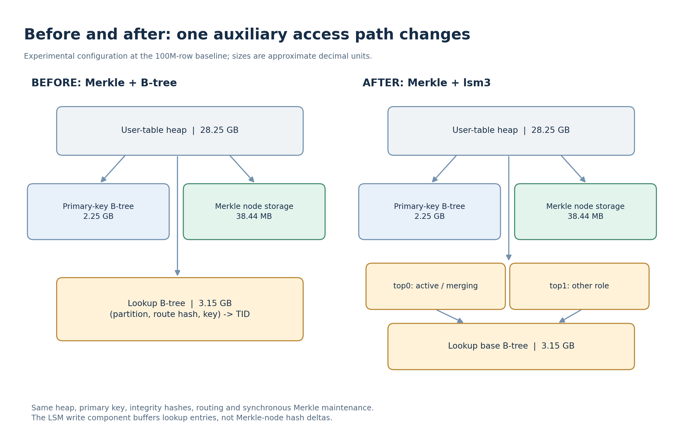

*Figure 1. The lookup stores `(partition, route hash, user key) → heap TID`; a TID points to an application tuple version.*

Source: [recorded catalogue][baseline], [LSM callbacks][lsmc].

## 2. Why the two storage documents have different numbers

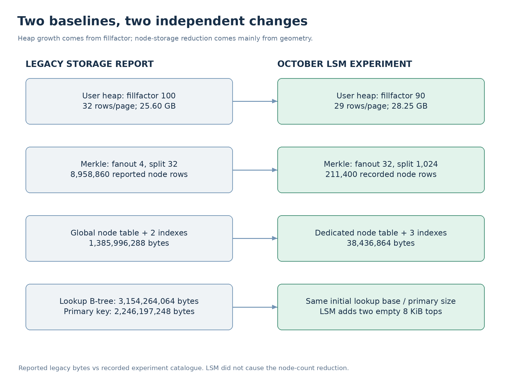

*Figure 2. These are different configurations. LSM did not cause the reduction from 8.96M to 211,400 Merkle nodes.*

The [legacy storage report][legacy] records the earlier footprint; the [October catalogue][baseline] records this experiment. Legacy values are historical reported measurements, not a new audit of that old database directory.

## 3. Deriving the 28.25 GB heap

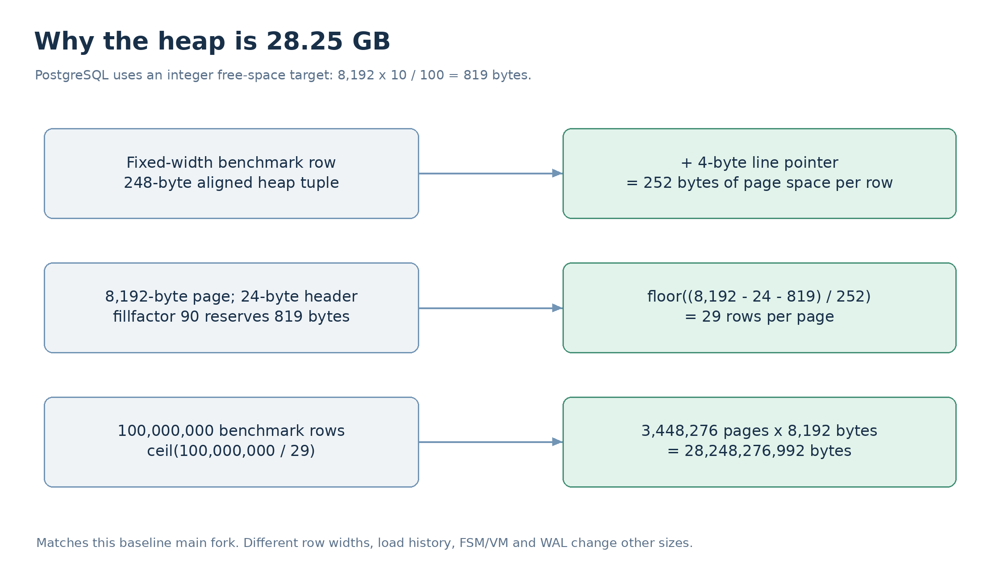

*Figure 3. `3,448,276 × 8,192 = 28,248,276,992 bytes`, or 28.25 GB / 26.31 GiB.*

This is the **heap main fork**, not the database directory including indexes, FSM/VM, and WAL. Sources: [row anatomy][legacy], [integer reserve][rel], [heap placement][hio], [measured size][baseline].

## 4. The node heap and its three indexes

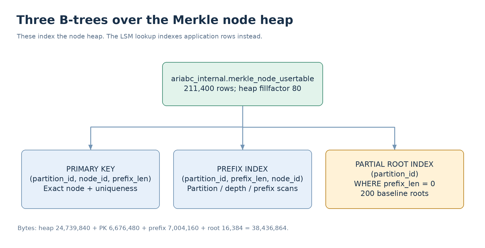

*Figure 4. Full names: `merkle_node_usertable_pkey`, `_prefix_idx`, and `_root_idx`; all index the node heap.*

The root index covers 200 roots **at this baseline**. It supports root-only predicates; “near-instant epoch verification” is not a measured latency claim. Sources: [DDL][util], [root reader][verify], [sizes][baseline].

## 5. The logical Merkle tree remains unchanged

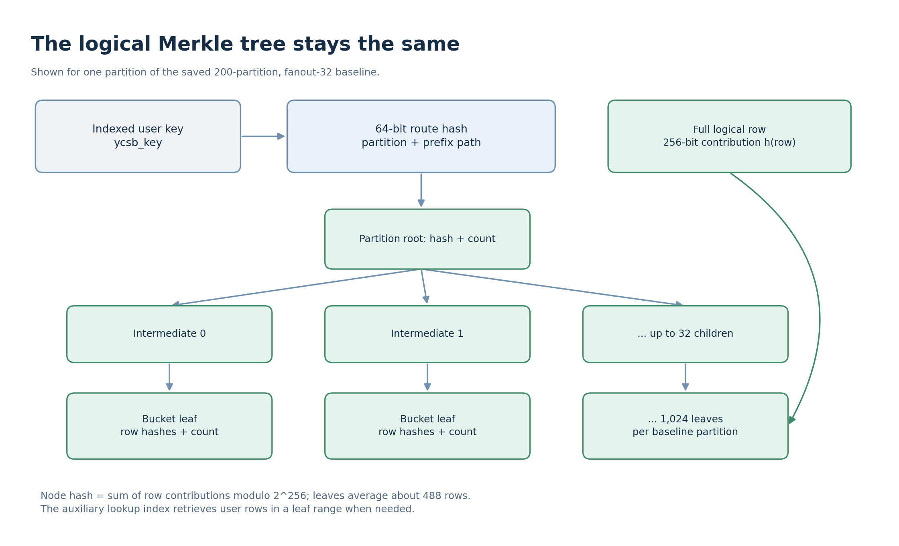

*Figure 5. Baseline geometry: `200 × (1 + 32 + 1024) = 211,400` nodes; 204,800 leaves; about 488 user rows per leaf.*

`H(node) = Σ h(row) mod 2^256`. INSERT adds; DELETE subtracts; UPDATE applies new minus old. The historical name `merkle_hash_xor()` now implements addition. Sources: [hashes][util], [pre-commit maintenance][delta].

## 6. Conventional LSM: background context

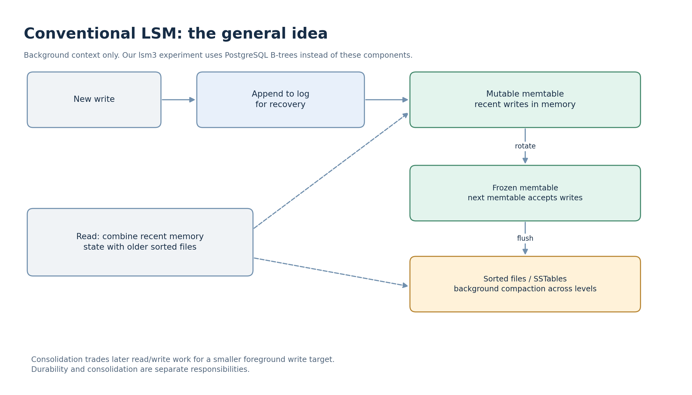

*Figure 6. A common LSM layout; these are not the experiment's physical components.*

The general idea is to collect recent writes in a small component and consolidate later. [LevelDB implementation description](https://github.com/google/leveldb/blob/main/doc/impl.md).

## 7. Our actual implementation: three PostgreSQL B-trees

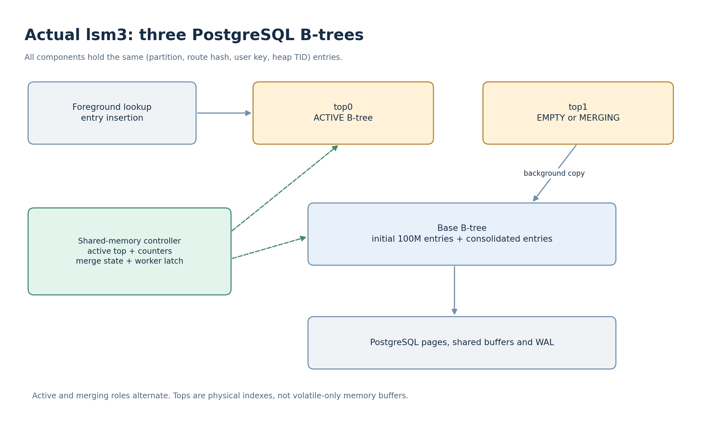

*Figure 7. “Active” and “merging” are alternating roles. Tops are WAL-backed PostgreSQL relations, not volatile-only memtables.*

No SSTables, Bloom filters, or external RocksDB commit path are involved. Source: [`Lsm3DictEntry`][lsmh], [extension][lsmc].

## 8. How we created it

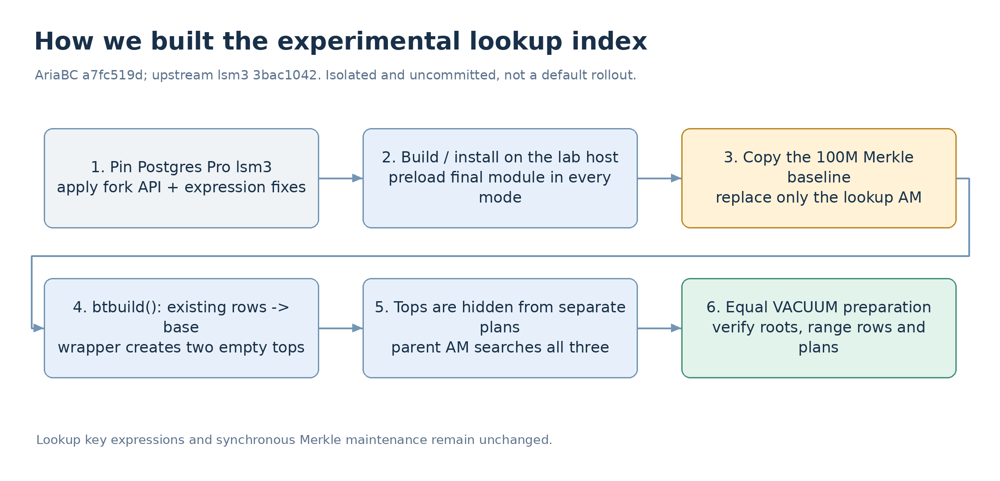

*Figure 8. We reused and adapted `lsm3`; the 100M existing entries enter the base build, not a top.*

Key settings: preload `lsm3` in all modes; `top_index_size=1024` KiB; 32 MiB shared buffers; synchronous Merkle application. Sources: [preparation / exact DDL][prepare], [build and utility hooks][lsmc].

## 9. Physical lookup-entry layout

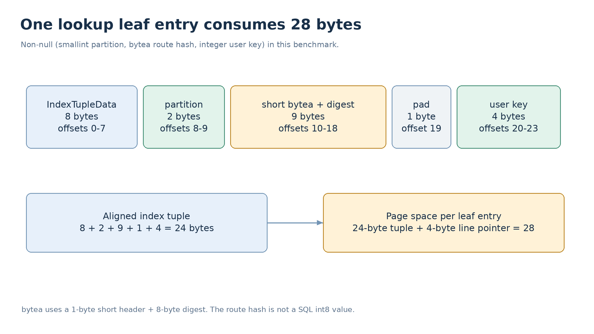

*Figure 9. `8 + 2 + 9 + 1 + 4 = 24` tuple bytes; plus a 4-byte line pointer gives 28 bytes per non-null leaf entry.*

**Correction:** SQL route hash type is `bytea`, not `int8`. This layout applies to this benchmark's keys, not every possible LSM index. Sources: [hash return value][util], [tuple formation][indextuple], [legacy physical layout][legacy].

## 10. Top capacity: packing estimate, not a limit

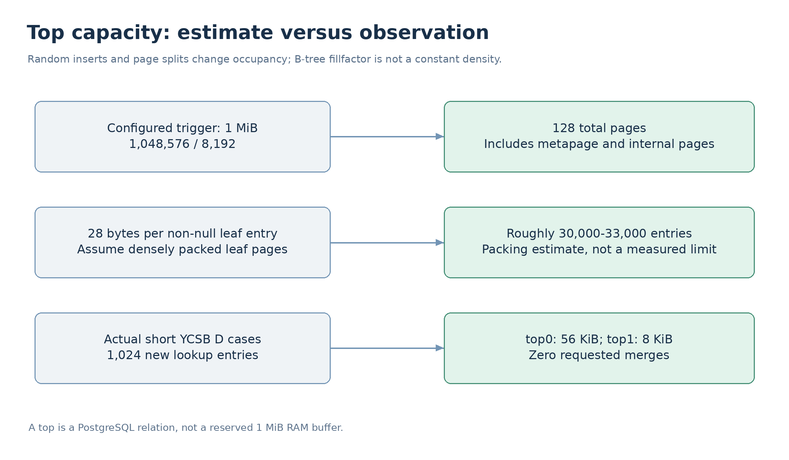

*Figure 10. About 30–33K entries is a dense-packing estimate. Random-insert tops also contain metadata, internal pages, high keys, and split slack.*

The proposed exact “262 data entries/page” ignores details such as high keys and PostgreSQL's byte-based free-space target. A top does not retain a fixed 90% density. Sources: [index storage description][legacy], [observed D counters][dsnapshot].

## 11. Foreground INSERT

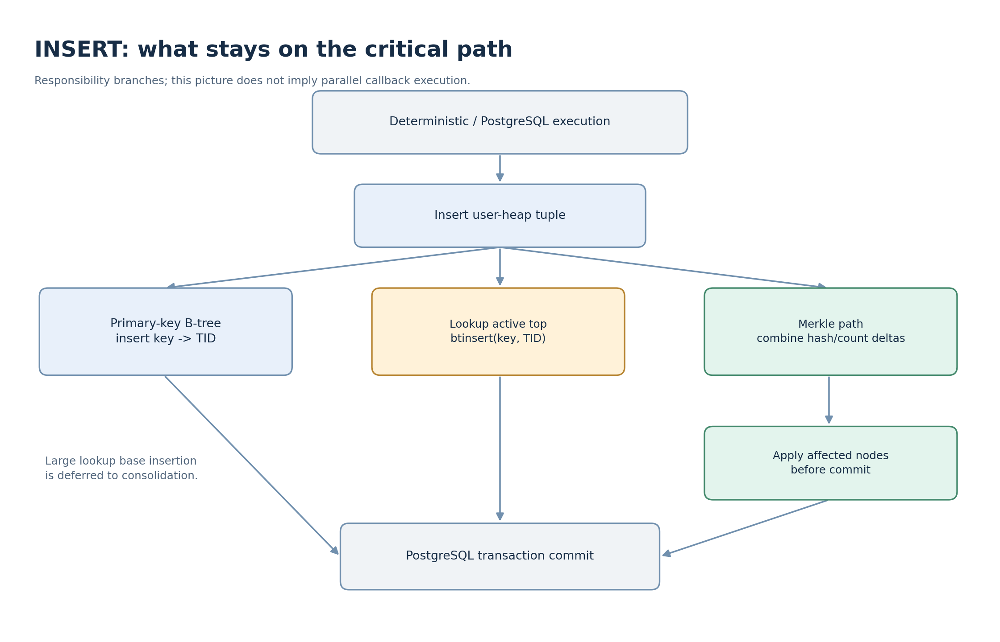

*Figure 11. These are responsibility branches, not parallel callbacks. The ordinary lookup insertion callback calls `btinsert()` on the active top.*

A committed row is queryable before its lookup entry reaches the base. Sources: [`lsm3_insert()`][lsmc], [synchronous Merkle application][delta].

## 12. Range reads search all components

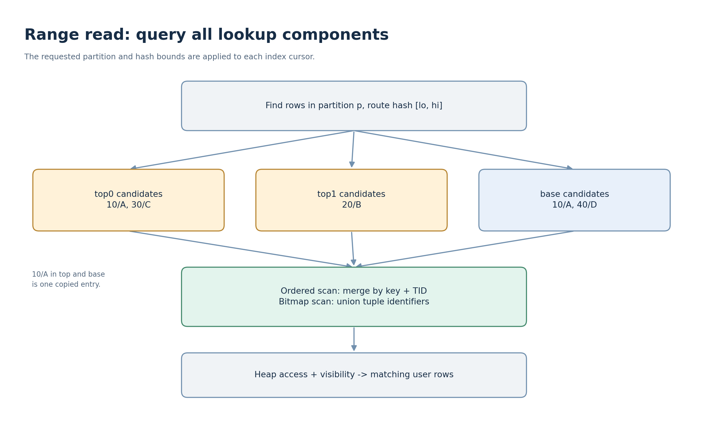

*Figure 12. Ordered scans suppress an identical key/TID copied into both top and base. Different tuple versions still require PostgreSQL visibility handling.*

Split and repair use partition/hash ranges; ordinary primary-key SELECTs can use the unchanged primary-key index. The LSM lookup does not enforce uniqueness. Sources: [scan callbacks][lsmc], [split SQL][apply], [tested repair query shapes][correctness].

## 13. Rotation and consolidation

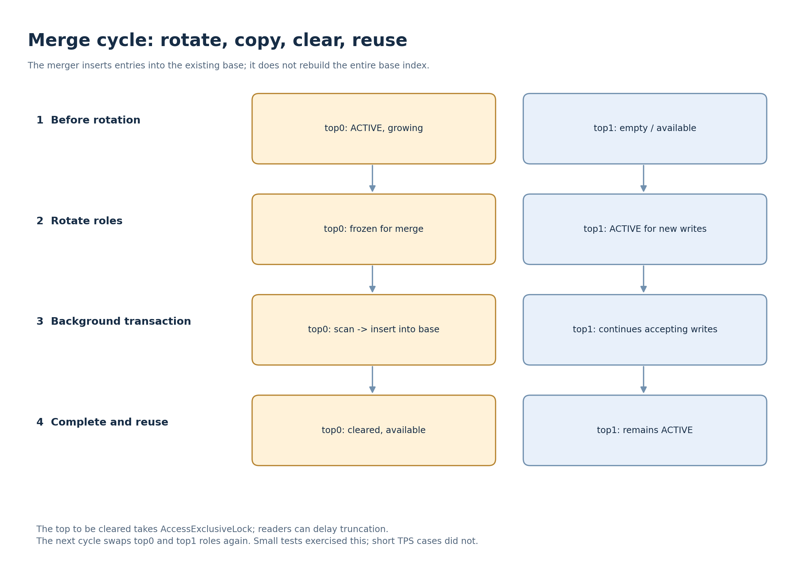

*Figure 13. The worker clears the old top after copying. It does not rebuild the entire 3.15 GB base.*

`lsm3_build_empty()` initializes the top's metapage without rescanning 100M user rows. Truncation still needs `AccessExclusiveLock`. Source: [merge, truncate, and empty-build callbacks][lsmc].

## 14. Why a nominal 1 MiB top can grow larger

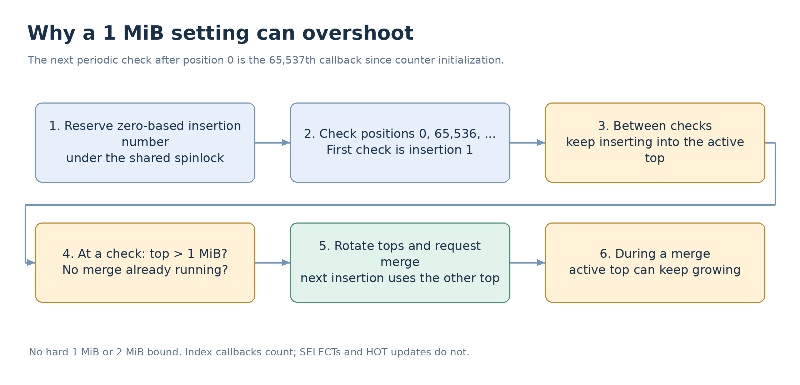

*Figure 14. Checks use zero-based positions `0, 65,536, …`; the first two checks are callbacks 1 and 65,537 after initialization.*

**Neither 1 MiB nor 2 MiB is a hard bound.** HOT updates and reads do not increment this index-insertion counter. Sources: [period constant][lsmh], [checked insertion path][lsmc].

## 15. Where the base-page cost goes

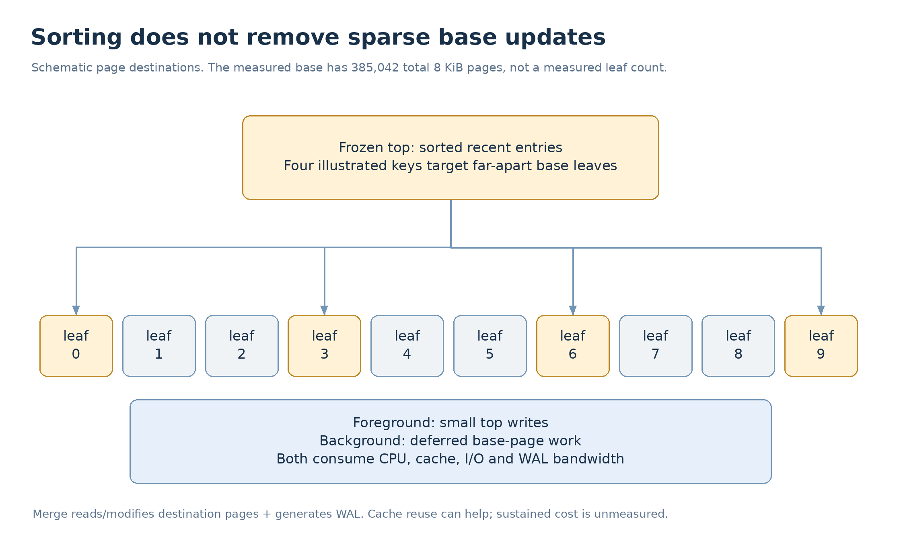

*Figure 15. Base size: 385,042 total 8 KiB pages. The leaf destinations shown are illustrative, not a measured merge trace.*

The merger still reads/modifies base pages, emits WAL, and competes for cache, CPU, locks, and device bandwidth. Sorted input can improve locality; repeated-merge performance remains unmeasured. Sources: [base size][baseline], [`_bt_doinsert()` merge loop][lsmc].

## 16. WAL during insertion, copying, and clearing

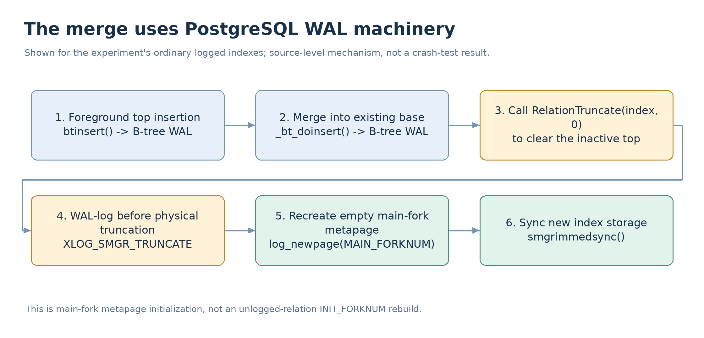

*Figure 16. For these logged indexes: B-tree insert records; `XLOG_SMGR_TRUNCATE`; then `log_newpage(MAIN_FORKNUM)` and storage sync.*

**Correction:** the empty-top builder writes a main-fork metapage, not an unlogged relation's init fork. Sources: [extension][lsmc], [B-tree WAL][nbtinsert], [`RelationTruncate()`][storage].

## 17. Restart and crash boundaries

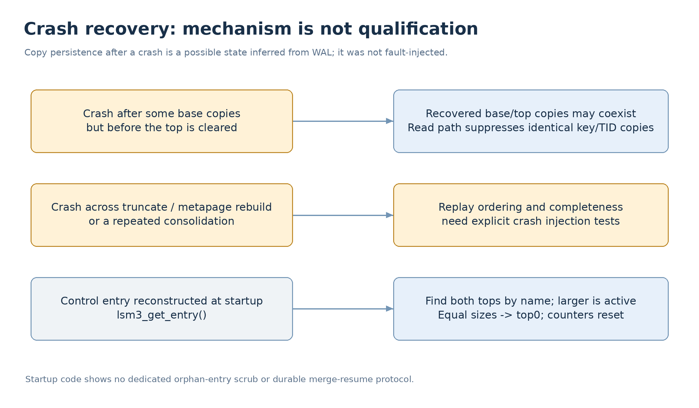

*Figure 17. `lsm3_get_entry()` reconstructs control state, chooses the larger top as active, and selects top0 on equal sizes.*

Persisted copies can require duplicate handling, but this is not a tested crash outcome. Startup shows no dedicated orphan scrub or durable merge-resume protocol. Native WAL and the worker transaction do not alone prove every interrupted merge safe. Source: [startup, scans, worker][lsmc].

## 18. COPY and the lock-release workaround

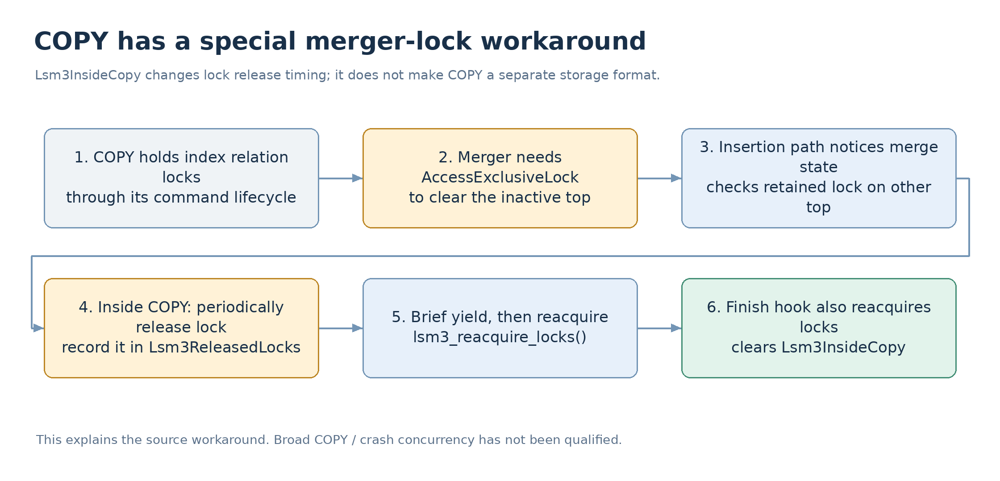

*Figure 18. `Lsm3InsideCopy`, `Lsm3ReleasedLocks`, `lsm3_reacquire_locks()`, and the executor-finish hook coordinate this workaround.*

The brief yield gives the worker a chance to obtain its lock; it is not a guarantee of contention-free progress. Source: [insertion / COPY / finish hooks][lsmc].

## 19. Why HOT updates differ from inserts

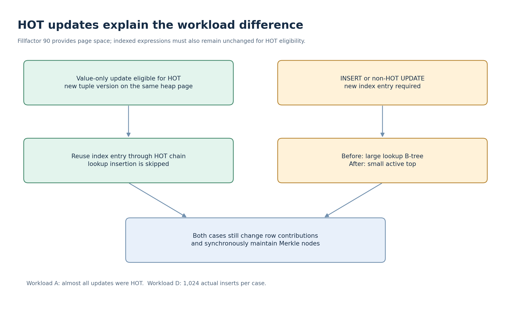

*Figure 19. Fillfactor 90 helps leave heap space. HOT also requires suitable same-page space and unchanged indexed attributes/expressions.*

A value update can avoid lookup insertion while still paying Merkle maintenance. A new row always needs a lookup entry. Sources: [heap placement][hio], [workload-A counters][report].

## 20. Extension defects we fixed

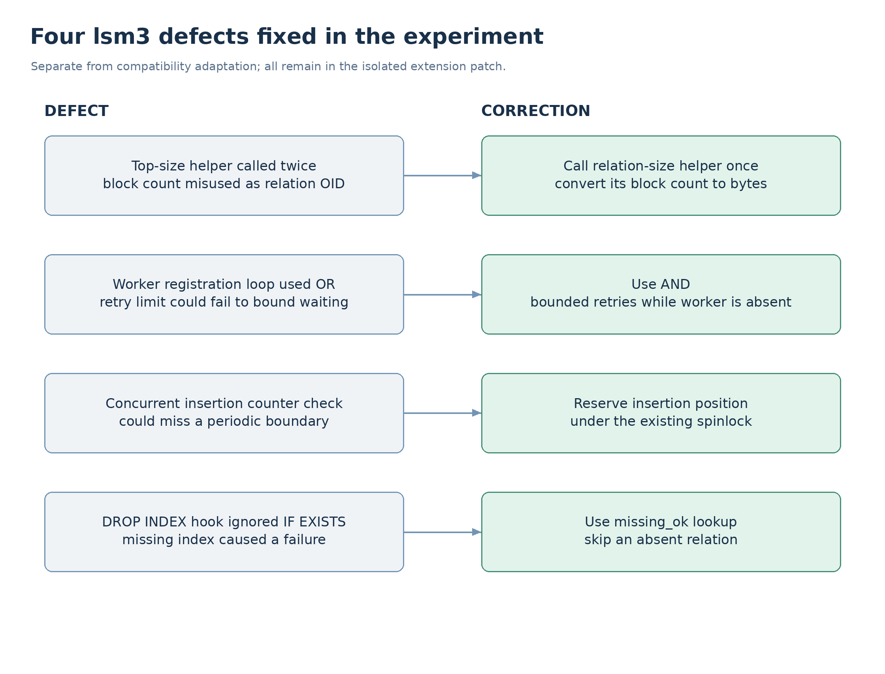

*Figure 20. Separate fork adaptations cover early PG13 APIs and expression-index transformation.*

The final library hash and exact uncommitted patch hashes remain in the [patch notes][patches] and [revision manifest][revisions]. No Merkle algorithm was changed for this experiment.

## 21. Harness fixes we made

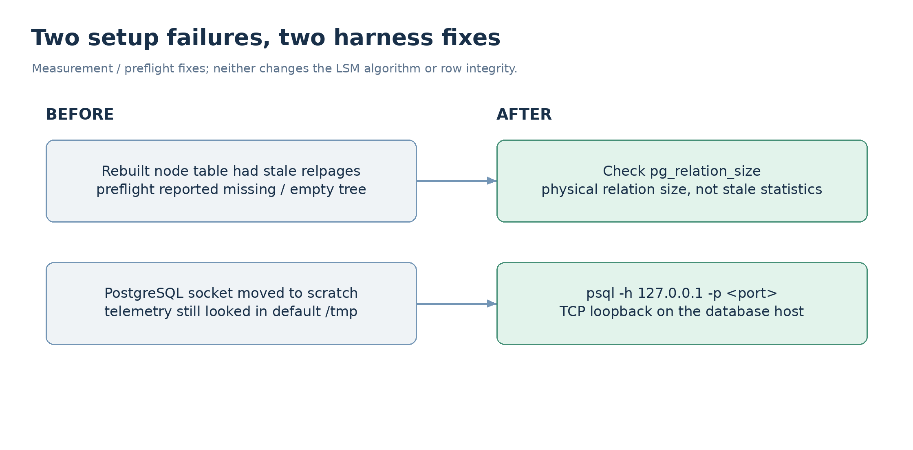

*Figure 21. The private PostgreSQL socket lives in campaign `scratch`; the sampler uses `psql -h 127.0.0.1 -p <configured port>`.*

Sources: [telemetry sampler][telemetry], [socket configuration][prepare], [retained setup-fix notes][patches].

## 22. Workload A: no consistent gain

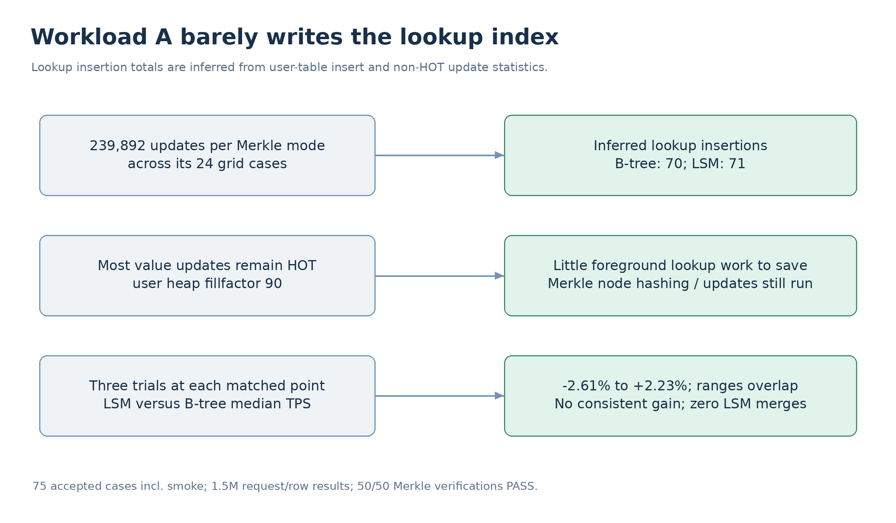

*Figure 22. Lookup-insertion counts are inferred from heap statistics, not direct AM callback counts. Trial ranges overlap at all eight matched points.*

The accepted A dataset has `divergence_count=0`, `permanent_failures=0`, and 50/50 full Merkle PASS results across 75 cases including smoke. Sources: [audited report][report], [audit][audit].

## 23. Workload D: short-window gain, no merges

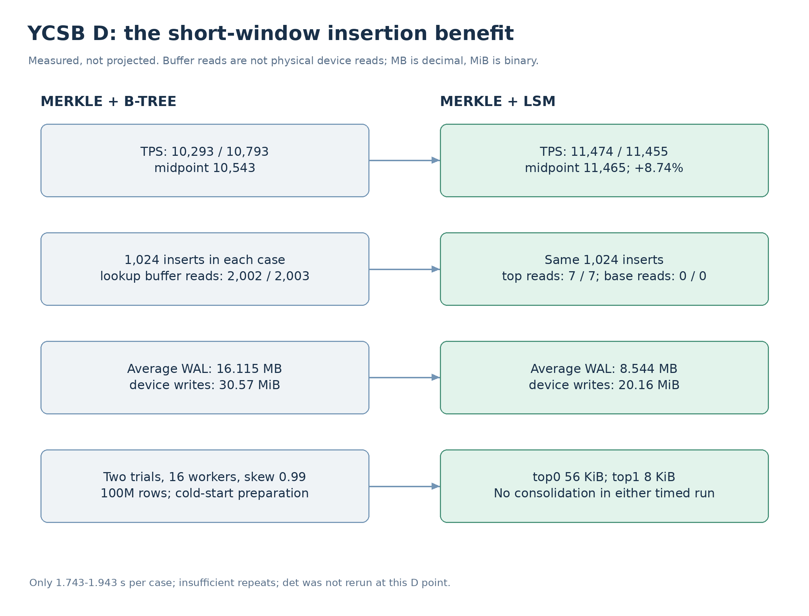

*Figure 23. All four cases: 20K validated requests, zero divergence/permanent failures, Merkle PASS. The small top absorbs all 1,024 new entries.*

Only two trials; about 1.8 seconds per measurement; no merges; qualification marked `insufficient_repeats`. Det was not rerun: the earlier “~40% gap closed” calculation used historical det. [Verified D snapshot][dsnapshot].

## 24. Tested behaviour versus open questions

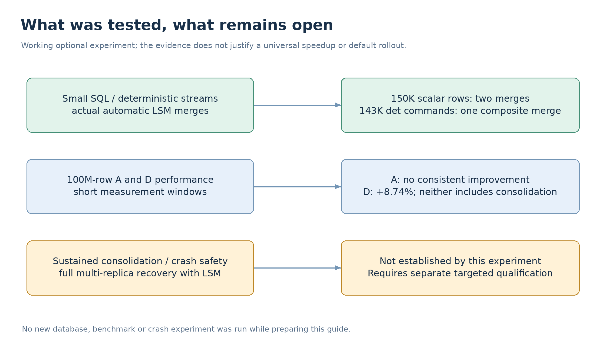

*Figure 24. The experiment demonstrates an insertion mechanism and bounded results, not a universal speedup.*

Sources: [small correctness / automatic merges][correctness], [100M results][report]. No new database or benchmark was started for this document revision.

## 25. Corrections to the proposed review

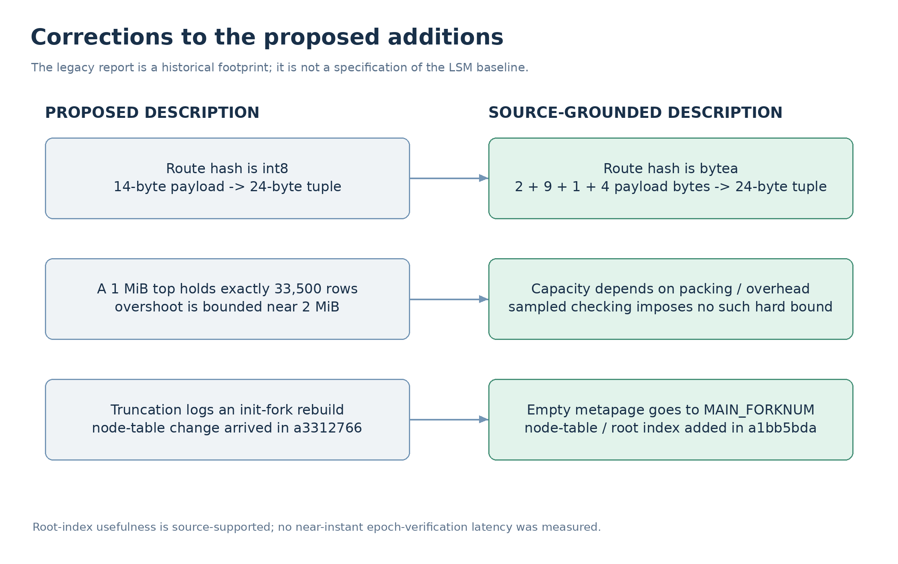

*Figure 25. Git history attributes the dedicated table/root index to `a1bb5bda` (19 September), already present before `a3312766` (2 October).*

**Kept:** both documents as configuration-specific references. **Added:** physical layout, sizing, three node indexes, deferred merge cost, WAL, restart limits, COPY locking, and both harness fixes.

## Source map

Links below refer to the inspected **local experiment snapshot**, except the legacy report and shared visual renderer. Line numbers can move after edits.

| Topic | Source entry point |
|---|---|
| Creation / empty tops | [`lsm3.c`][lsmc]:445, :842, :960 |
| INSERT / COPY locks | [`lsm3.c`][lsmc]:488, :1130 |
| Read union / duplicates | [`lsm3.c`][lsmc]:606, :689, :765 |
| Merge / truncate / restart | [`lsm3.c`][lsmc]:244, :224, :318, :143 |
| Period and shared state | [`lsm3.h`][lsmh] |
| Node DDL / route hash | [`merkleutil.c`][util]:1626, :1393 |
| Root-only predicate | [`merkleverify.c`][verify]:451 |
| Heap reserve / placement | [`rel.h`][rel]:308; [`hio.c`][hio]:334–351, :503 |
| Physical tuple / WAL | [`indextuple.c`][indextuple]:47; [`nbtinsert.c`][nbtinsert]:1134; [`storage.c`][storage]:228 |
| New diagram source | [`render_visual.py`](lsm_lookup_diagrams/render_visual.py), using the [existing figure helpers](merkle_implementation_diagrams/render.py) |

[baseline]: ../evidence/baseline_evidence/baselines_normalized/base_ff90_lsm.json
[legacy]: ../scripts/distributed/OOM_100M_DATABASE_STORAGE_BREAKDOWN.md
[lsmc]: ../lsm3_source/lsm3.c
[lsmh]: ../lsm3_source/lsm3.h
[util]: ../../../../src/backend/access/merkle/merkleutil.c
[delta]: ../../../../src/backend/access/merkle/merkledelta.c
[verify]: ../../../../src/backend/access/merkle/merkleverify.c
[apply]: ../../../../src/backend/access/merkle/merkleapply.c
[prepare]: ../harness/prepare_baselines.py
[telemetry]: ../../../../scripts/distributed/benchmark_telemetry.py
[rel]: ../../../../src/include/utils/rel.h
[hio]: ../../../../src/backend/access/heap/hio.c
[indextuple]: ../../../../src/backend/access/common/indextuple.c
[nbtinsert]: ../../../../src/backend/access/nbtree/nbtinsert.c
[storage]: ../../../../src/backend/catalog/storage.c
[correctness]: ../CORRECTNESS.md
[report]: ../REPORT.md
[audit]: ../AUDIT.md
[patches]: ../PATCH_NOTES.md
[revisions]: ../evidence/source_revision.json
[dsnapshot]: ../ycsb_d_run_20261015/ycsb_d_verified_snapshot.json
