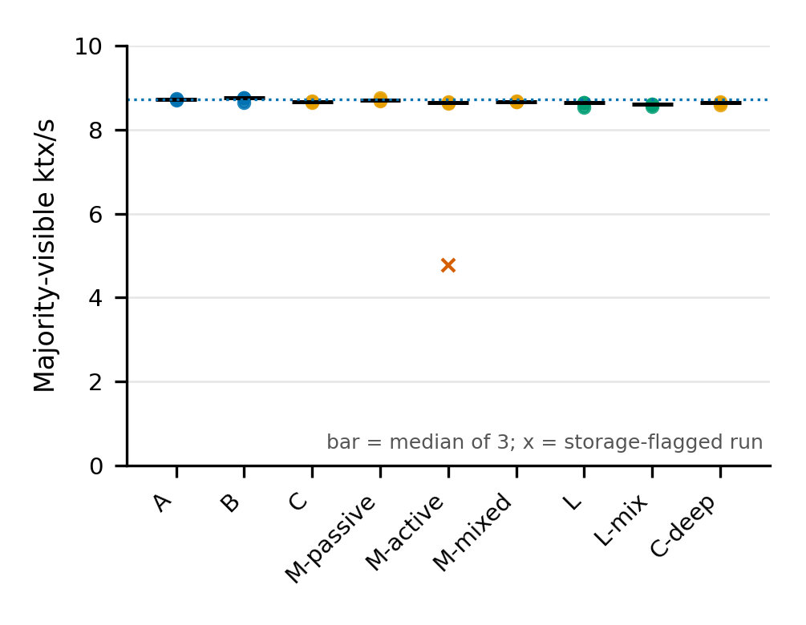
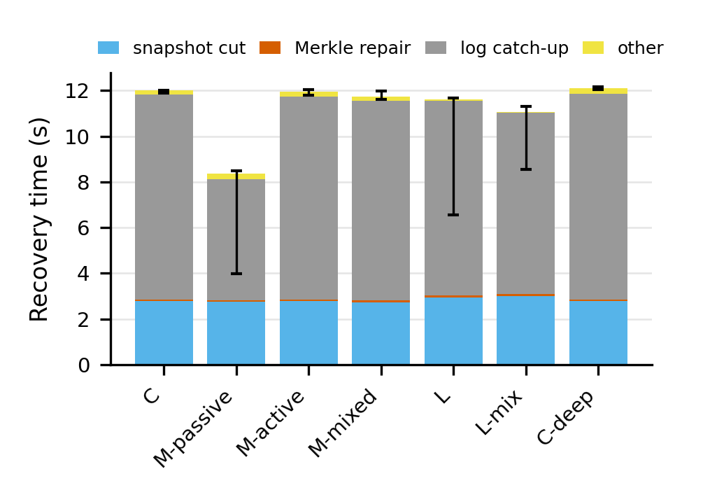
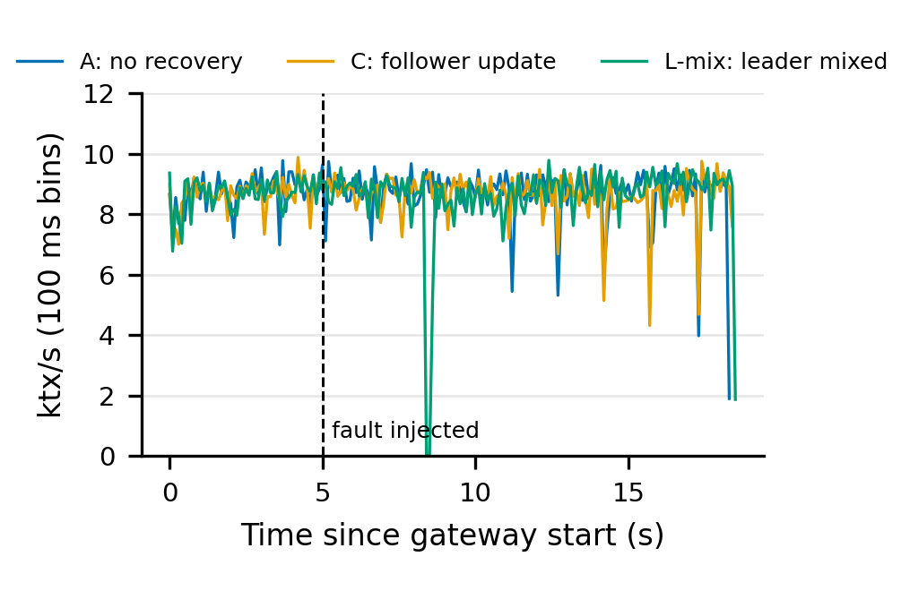

# Distributed online replica recovery — paper re-measurement (2026-10-12)

**Primary result.** 27 planned runs (9 scenarios × 3 rotated repetitions) on the frozen commit
`16577072ecf888fbbbb5d80d0e90fc340c8ca342`, plus one extra attempt. Every run reached 160,000/160,000
quorum completions, passed the all-three result audit, and ended with identical row counts, Merkle roots
(`80566f7114b529dda1e6da732dab5462a8cdbce998afa5fec073e224d0ea6ad5`) and `merkle_verify()=t` on all three replicas.
Zero divergence, permanent failures and full-table copies. Online recovery repairs a corrupted replica while
clients keep running: median throughput stays within **−1.43% to +0.34%** of the no-recovery baseline in
every scenario. The earlier single-trial report is kept unchanged in [Report.md](Report.md) and its run folders.

All figures exist as PDF and PNG in [paper_20261010/figures](paper_20261010/figures). Every number below comes
from [scenario_summary.csv](paper_20261010/scenario_summary.csv) and [all_attempts.csv](paper_20261010/all_attempts.csv),
produced by [analyze.py](paper_20261010/analyze.py) from the curated run folders in [paper_20261010/runs](paper_20261010/runs).

## Setup

| Item | Value |
|---|---|
| Cluster | Gateway, sequencer, auditor and recovery coordinator on `.111` (10.129.27.111, clocksource `tsc`). Replicas: node 1 `.247` (admin123, Raft leader), node 2 `.246` (user4, memory-constrained), node 4 `.248` (utkarsh). |
| Ordering / completion | Raft + Kafka (`raft-kafka`, leader-assigned ordering), `kafka_majority`, validation `majority_async_all3` |
| Workload | 160,000 YCSB-A θ=0 transactions over `usertable_small` (12,000 rows), 96 client lanes, deterministic execution, det window 65536 (as in the earlier recovery runs) |
| Merkle | 200 partitions, fanout 32, split 1024, merge 256; synchronous maintenance; durability on |
| Isolation | SERIALIZABLE everywhere, including the fault injector (whole-transaction retries with capped full-jitter backoff) |
| Kafka | Isolated campaign Kafka 3.7.0 cluster (new identity, ports 9192/9193, 512 MiB heap per broker) |
| Result audit deadline | 180 s (`--pollIntervalUs 500 --pollCount 360000`), identical for every scenario |
| Builds | PostgreSQL fork and server/gateway built from the frozen commit in isolated directories (Ubuntu 22.04 container, `--enable-depend`); hashes in [provenance](paper_20261010/provenance) |

| Scenario | Recovery mode | Fault (100 tuples at t = 5 s) |
|---|---|---|
| A | off | none (baseline) |
| B | both | none (recovery overhead) |
| C | both | UPDATE corruption on follower node 4 |
| M_passive | passive (periodic Merkle comparison) | UPDATE on node 4 |
| M_active | active (result divergence) | UPDATE on node 4 |
| M_mixed | both | mixed UPDATE/DELETE/INSERT on node 4 |
| L | both | UPDATE on leader node 1 |
| L_mix | both | mixed on leader node 1 |
| C_deep | both | as C, with gate telemetry, block profiles, per-transaction phase tracing and OS profiling (diagnostic variant) |

Run order rotates by three scenarios per repetition block. Acceptance (per run): 160,000/160,000 quorum
completions; successful all-three audit; zero terminal divergence, permanent failures, timeouts and missing votes;
gateway/runner/collector exit 0; identical final counts, roots, data digests and passing `merkle_verify()` on all
three nodes; successful SERIALIZABLE injection and live recovery of the intended target for fault scenarios
(`merkle_compare` detection for M_passive); geometry F32/S1024/M256/P200 and durability on.

## Throughput (majority-visible, 3 repetitions)

| Scenario | n | Median TPS | Min–max TPS | Δ vs A (median) | Max gap ms (worst run) | Empty 100 ms bins (worst run) |
|---|---:|---:|---:|---:|---:|---:|
| A | 3 | 8,724 | 8,710–8,742 | +0.00% | 19.8 | 0 |
| B | 3 | 8,754 | 8,647–8,769 | +0.34% | 21.1 | 0 |
| C | 3 | 8,667 | 8,636–8,690 | −0.66% | 20.1 | 0 |
| M_passive | 3 | 8,704 | 8,679–8,754 | −0.23% | 21.2 | 0 |
| M_active | 3 | 8,637 | 8,625–8,667 | −1.00% | 20.3 | 0 |
| M_mixed | 3 | 8,674 | 8,671–8,684 | −0.58% | 41.2 | 0 |
| L | 3 | 8,644 | 8,537–8,652 | −0.92% | 192.8 | 1 |
| L_mix | 3 | 8,599 | 8,554–8,615 | −1.43% | 134.6 | 1 |
| C_deep | 3 | 8,651 | 8,586–8,670 | −0.84% | 25.2 | 0 |

Follower recovery has no visible client stall: the longest completion gap (≈20 ms, 41 ms once) equals the
fault-free baseline. Recovering the **leader** produces one short completion gap of 77–193 ms per run (at most one
empty 100 ms bin) during the leader's recovery; its exact cause within the leader path was not isolated.

## Recovery time and repair volume

| Scenario | Median cut ms | Median repair ms | Median catch-up ms | Median total ms (min–max) | Median partitions | Median rows upserted / deleted | Full copies |
|---|---:|---:|---:|---:|---:|---:|---:|
| C | 2,747 | 61 | 8,982 | 11,996 (11,896–12,009) | 28 | 33 / 0 | 0 |
| M_passive | 2,769 | 50 | 5,314 | 8,374 (3,973–8,476) | 10 | 11 / 0 | 0 |
| M_active | 2,783 | 59 | 8,904 | 11,948 (11,802–12,052) | 31 | 37 / 0 | 0 |
| M_mixed | 2,763 | 92 | 8,721 | 11,747 (11,599–11,967) | 61 | 41 / 34 | 0 |
| L | 2,967 | 64 | 8,539 | 11,620 (6,560–11,687) | 35 | 37 / 0 | 0 |
| L_mix | 3,009 | 97 | 7,926 | 11,074 (8,536–11,294) | 70 | 45 / 34 | 0 |
| C_deep | 2,778 | 58 | 9,017 | 12,099 (12,034–12,154) | 28 | 32 / 0 | 0 |

The Merkle repair itself (localize differing leaves across 200 partitions and copy only those rows) takes
**50–97 ms**; no run fell back to a full table copy. Recovery time is dominated by the snapshot cut (~2.8–3.0 s)
and by replaying the Raft log entries committed since the cut (catch-up). Catch-up is shorter when the corruption
is detected later in the run (fewer remaining entries): M_passive detects through periodic Merkle comparison
(detection at det_seq 97,535–137,727 versus mostly 66,000–73,000 for result divergence/audit mismatch); among
the leader runs, L r1 and L_mix r3 were detected later (det_seq 114,431 and 96,511), giving their shorter totals. The phase figure plots the median-total run of each scenario so that its phases sum to its
total; "other" is detection-to-quarantine, drain and sequence rebase.

Detection path is timing dependent: most fault runs detect by result divergence; C r3, C_deep r1/r3 and the
M_active extra attempt detected by audit mismatch first. Every detection led to a successful live recovery.

## Extra attempt and storage-stall flag

M_active repetition 2, attempt 1 was accepted by the predeclared rules but ran at 4,765 TPS (−45%) with
89 empty 100 ms bins and a 4.2 s gap. Its evidence shows a **storage stall on node 1 (.247)**, independent of
recovery: the leader's Raft-log `fdatasync` total was 6,225 ms (p99 113 ms, max 426 ms) versus a node median of
1,016 ms (p99 ≈2.8 ms); the node fell behind from t = 2 s, before the fault at t = 5 s. Because node 4 was the
corrupted replica, the majority needed node 1's results, so client throughput followed node 1's apply rate and
recovery only triggered at the end of the workload (det_seq 159,999, by which time later writes had overwritten
all but one corrupted row).

The predeclared noise rule covered swap only, so this rule was added **post hoc** and applied uniformly to every
node of every run: *a run is storage-flagged if any node's total Raft-log fdatasync time exceeds 2× that node's
median over all matrix attempts.* It flags exactly this one run ([storage_flags.csv](paper_20261010/storage_flags.csv)).
The run is kept as raw evidence and shown as × in the throughput figure; one extra attempt (M_active r2 a2:
8,625 TPS, total recovery 12,052 ms, normal fsync on all nodes) replaces it in the primary statistics. Including the
flagged run, the M_active median of all four accepted attempts is 8,631 TPS
([flagged timeline](paper_20261010/figures/recovery_flagged_storage_stall.png)).

## Limitations

- One workload (YCSB-A over a 12,000-row table) and three repetitions per scenario; min–max are observed extremes, not confidence intervals.
- `.246` is memory constrained (minimum MemAvailable ≈0.5 GB in some runs); its swap stayed under the 64 MiB noise threshold in every accepted run. `.248` ran out of memory during the first C smoke attempt and was rebooted externally; that smoke run is rejected and retained. Smoke runs never enter statistics.
- The old "unprioritized slow reference" leader runs are history only: current code orders reference candidates by committed watermark and has no switch to reproduce the old path.
- Det trace counters (`dt_opf`, `dt_opf_stale_error`, `dt_rel_read_tags`) were not sampled in these runs (reported as unavailable, not zero).
- The isolated Kafka cluster and 180 s audit deadline differ from the earlier published runs; the earlier single-trial A baseline was 8,850 TPS versus 8,724 now.
- The storage-stall rule is post hoc (see above).

## Evidence

- Curated runs (bulk per-transaction traces omitted; each folder has `CURATED.sha256`): [paper_20261010/runs](paper_20261010/runs) — 27 matrix runs, 1 extra, 6 smoke attempts.
- Controller status, attempt logs and plans: [paper_20261010/controller](paper_20261010/controller).
- Harness changes (no engine change) and preparation scripts: [paper_20261010/harness](paper_20261010/harness).
- Provenance (binary hashes, inputs, container image, git state): [paper_20261010/provenance](paper_20261010/provenance).
- Raw campaign including bulk traces: `.111:/home/neel/ariabc_data/paper_20261010_recov/`.
