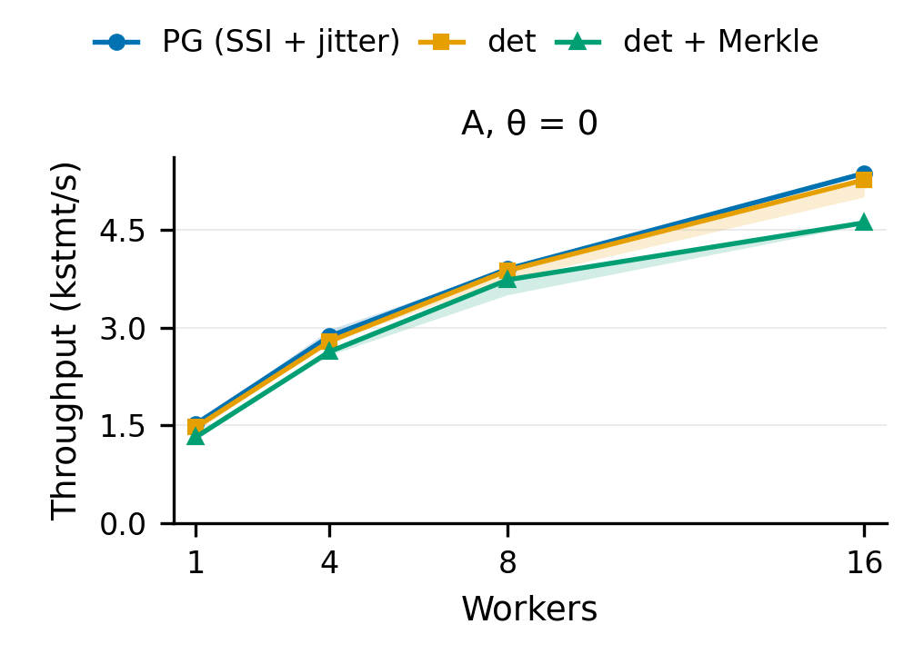
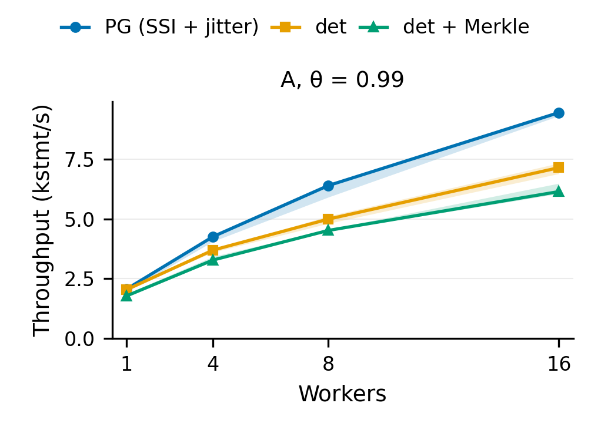
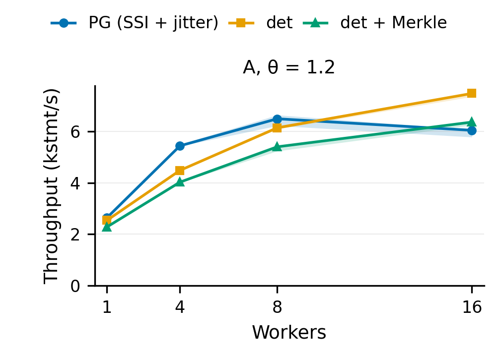
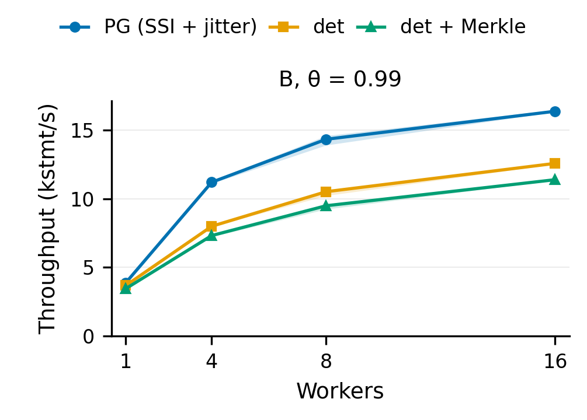
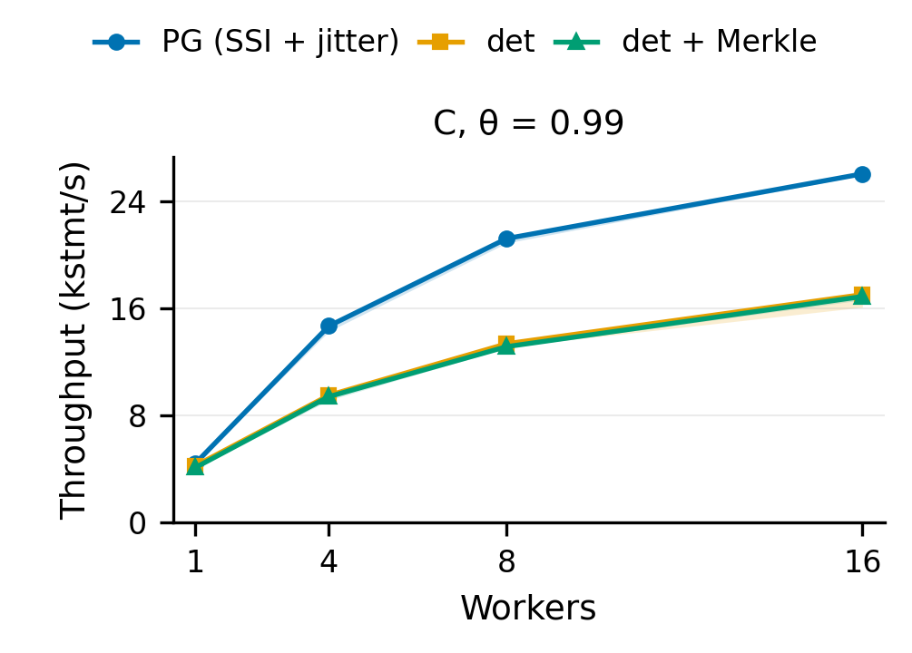
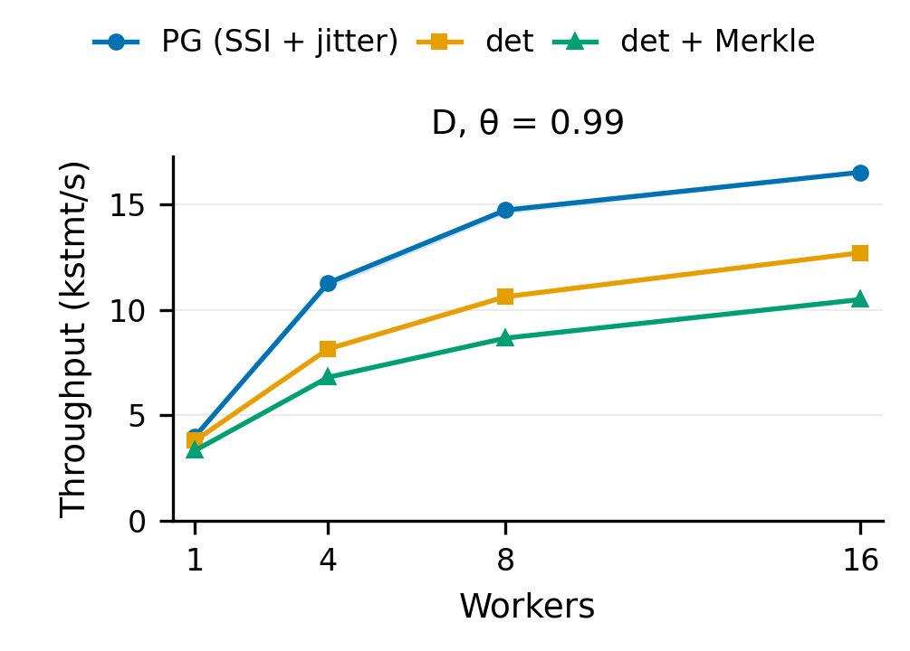
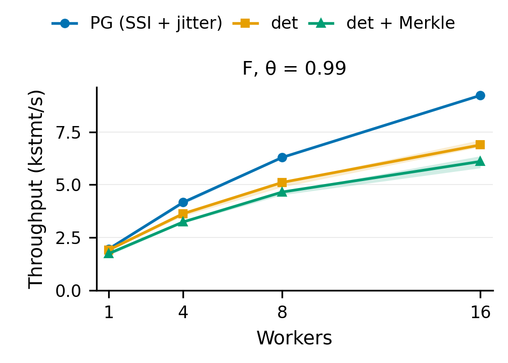
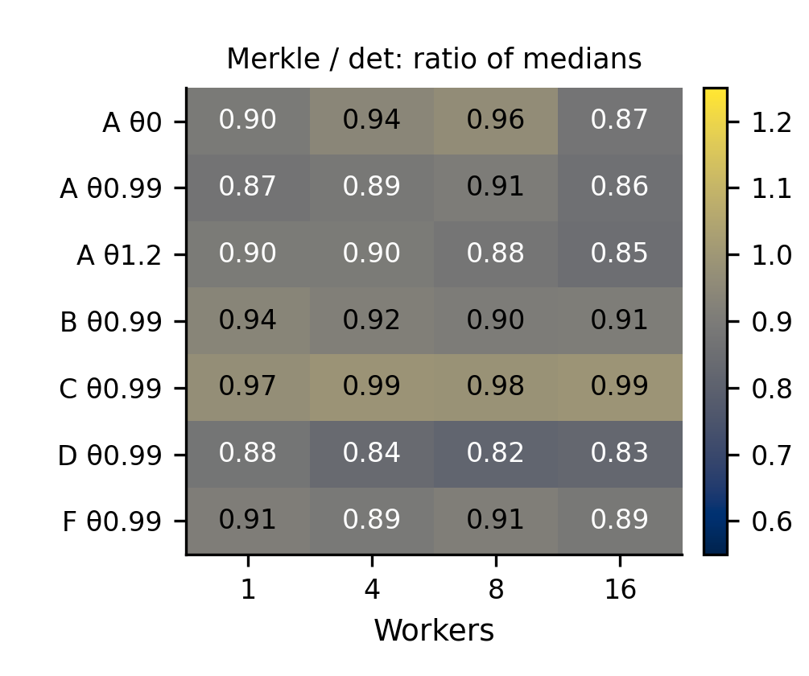

# OOM 100M: three-trial paper re-measurement

The completed campaign contains **252 accepted cases across 84 configuration points**, plus **three accepted smoke cases**. All **5,100,000 terminal results** passed the raw completion and row-result audit; divergence, permanent failures and exhausted retries are zero. Every Merkle case passed post-run verification: **84 campaign + one smoke**. No attempt was rejected or excluded, and the independent audit found no incorrectly accepted case under the recorded contract. Counts are in [audit_counts.csv](paper_20261010/phase2/audit_counts.csv); per-case checks are in [audit_cases.csv](paper_20261010/phase2/audit_cases.csv).

Primary values are medians of three trials. Across the 28 matched workload/skew/worker points, the median **det/PG ratio is 0.846**, **Merkle/det is 0.898**, and **Merkle/PG is 0.755**. These are medians of matched ratios, not aggregate throughput. Merkle/det ranges **0.815–0.992**. Source: [headline_numbers.csv](paper_20261010/phase2/headline_numbers.csv) and [matched_ratios.csv](paper_20261010/phase2/matched_ratios.csv).

## Setup and frozen provenance

| Item | Recorded value |
| --- | --- |
| Engine commit | `16577072ecf888fbbbb5d80d0e90fc340c8ca342` |
| Hosts | DB/server .247 (`10.129.148.247`); controller/gateway .111 (`10.129.27.111`) |
| Isolation | SERIALIZABLE in all modes; PG retries with full jitter |
| Data | Fresh COPY of 100,000,000 rows; fillfactor 90; full keyspace scan before measurement |
| Common heap | 28,248,276,992 bytes (26.31 GiB), 3,448,276 pages |
| Stopped baselines | Merkle 35,866,524,242 bytes; plain 32,712,269,772 bytes |
| Merkle | Synchronous maintenance; 200 partitions, fanout 32, split 1024, merge 256 |
| Initial tree | 211,400 nodes; 204,800 leaves; node heap 24,739,840 bytes, total 38,469,632 bytes |
| Timed settings | 32MB shared_buffers; fsync/full_page_writes/synchronous_commit on; wal_compression off; autovacuum off |
| Inputs | Seed 42; 20,000 SQL statements; A θ0/.99/1.2 + B/C/D/F θ.99 |
| Workers and modes | Workers 1/4/8/16; PG, det, det + synchronous Merkle; three trials each |
| Execution | Standalone, Raft bypassed; direct protocol v2; 96 terminals and 96 det client workers; publication gate source 0 |
| Ports | DB 5468; client 8068; Raft endpoint 9068 |
| Generation | 512MB shared buffers; 1GB maintenance_work_mem; two maintenance workers; memory guard 4608MB |
| Environment | DB host AMD Ryzen 7 5700G, approximately 15GB RAM; DB kernel 7.0.0-38-generic, gateway 7.0.0-34-generic; .111 clocksource tsc |
| Completion | 2026-10-10T20:42:31Z to 2026-10-11T11:13:44Z (14.52 hours for full campaign) |

Setup values: [setup_and_audit_facts.csv](paper_20261010/phase2/setup_and_audit_facts.csv), saved [arguments](paper_20261010/phase2/evidence/campaign/campaign.json), [baseline verification](paper_20261010/phase2/evidence/baseline_evidence/verification.json), and [runtime environment](paper_20261010/phase2/evidence/provenance/runtime_environment.json). The plain baseline is derived from the same freshly generated heap by dropping the integrity indexes. Older OOM data was not reused.

The isolated PostgreSQL build used `--enable-depend`; matching C++ Release binaries were built on .111. The immutable source archive SHA-256 is `bce56e38179adf8d34cb480e1310b92f8d77d265bf14ba64909d0e84f70aa193`. The audit compared all **9,862 archived files** with frozen git blobs and checked the **7,301-file engine/build manifest**. Harness-only overlays and the restored ignored workload generator are recorded as patches; engine/server/gateway source has no changes. See [source_and_fetch_checks.json](paper_20261010/phase2/source_and_fetch_checks.json) and [patch notes](paper_20261010/phase2/evidence/provenance/PATCH_NOTES.md).

| Binary | SHA-256 |
| --- | --- |
| postgres | `ec3edb9d3e72ea377f4c6c75df6d14a5cf9b218d770f26bdd4453bd3b4c2e067` |
| ariabc_pg_gateway | `f7a6c682900e88e3daa403e2c8a1c53584338dbf85d71efb616cf08d85eb727d` |
| ariabc_pg_server | `28300bf543cf0512476482e72e3dfc3b119603ea79c65f2e299dcededd1b0e76` |

All per-case executable manifests and the initial preflight hashes agree with build provenance; current read-only checks of all three binaries and recorded PG/C++ dependencies also match. Source: [binary_hashes.csv](paper_20261010/phase2/binary_hashes.csv), [audit](paper_20261010/phase2/audit_raw.json), and [dependency checks](paper_20261010/phase2/evidence/247_binary_recheck.json).

## Method and timing

1. Generate from scratch with the frozen binaries, build the Merkle index, full-scan count/bounds and verify fillfactor, geometry, storage and `merkle_verify`. Preserve stopped plain and Merkle baselines and the golden archive.
2. Restore the stopped baseline to the mode's working copy using `rsync --inplace --no-whole-file`. Fast catalog/size checks occur every case. Full byte checks occur on the first restore and every tenth restore per baseline variant; the audit found **27 campaign and two smoke** content checks. Physical reset is used throughout.
3. Calibrate idle random-read QD1/QD8 and O_DSYNC write latency, then settle after each restore. Require three consecutive idle probes within `max(1.25 × idle latency, idle + 30µs)` for reads and `max(1.25 × idle latency, idle + 50µs)` for writes, at most 2MiB unrelated writes per probe. Minimum wait is 20s and maximum 1800s. Every case's final three probes passed the recorded rounded thresholds. Calibration ran for at least 300s.
4. Drop OS caches after reset validation and settling; start PostgreSQL cold. Execute a randomized set of workload/worker blocks with rotating mode order. Each mode occupies each block position once across the three trials. The complete actual sequence matches [planned_case_order.csv](paper_20261010/phase2/evidence/provenance/planned_case_order.csv).
5. Validate every terminal completion and operation row result. Measure a separate checkpoint, restart to persist PG statistics, and run full post-workload Merkle verification for every Merkle case.

TPS is **20,000 / gateway workload wall seconds**. Restore, settle, startup, checkpoint and verification are outside this interval. Device counters cover a wider interval and include unrelated device traffic; they are not exact gateway-only I/O. PostgreSQL block reads can hit the OS cache. The actual timed workload files, including each gateway-side copy, match all seven previous published workload hashes ([workload_hashes.csv](paper_20261010/phase2/workload_hashes.csv)). These are the repository's custom SQL YCSB variants, not an upstream YCSB client.

## Independent audit, noise and limitations

| Dataset | Accepted | Rejected | Excluded | Terminal results | Merkle PASS |
| --- | --- | --- | --- | --- | --- |
| smoke | 3 | 0 | 0 | 60,000 | 1 |
| campaign | 252 | 0 | 0 | 5,040,000 | 84 |

A second parser independent of the harness also checked every terminal ID/tag, the SQL operation mix and every emitted gateway error counter; its [results](paper_20261010/phase2/independent_terminal_check.json) pass all cases. The audit re-parsed all gateway and server row-result logs, checked exact request IDs/counts, return codes, saved settings and mode commands, recomputed workload hashes and TPS, re-evaluated telemetry, checked settling, and extracted det counters again. All terminal row results were present; there were no empty results. `all_attempts.csv` matches the accepted rows, with no extra attempts or failure/noise/cleanup markers. Raw case files remain remotely; [REMOTE_RAW_SHA256SUMS](paper_20261010/phase2/REMOTE_RAW_SHA256SUMS) identifies **3,655 files**. Locally fetched case evidence contains **2,125 files / 10,158,196 bytes**, each verified against those hashes. No pgdata or bulk server traces were fetched. See [AUDIT.md](paper_20261010/phase2/AUDIT.md).

The same predeclared exclusion rule applies to every mode: invalid/error telemetry; sampler gap ≥10s; full I/O PSI ≥95% or full memory PSI ≥50% over a window ≥10s. No case met it. Max observed sampler gaps were **1.000539s on .247** and **1.000738s on .111**; boot IDs were stable during all measurements and every .111 sample used tsc. Maximum qualifying full-I/O-pressure fraction on .247 was **0.440**. Background load remains in the measurements; .111 was shared with another user's PostgreSQL at preparation. **225 DB telemetry windows and 227 gateway windows were shorter than 10s**, so many cases cannot support the ten-second pressure test. Workload wall times range **763–15243ms**. A passing rule is not proof of a noise-free host. Source: [telemetry_summary.csv](paper_20261010/phase2/telemetry_summary.csv).

`dt_opf`, `dt_opf_stale_error` and `dt_rel_read_tags` were **not emitted in any campaign or smoke log**. All remain null/unavailable, not zero. Saved profiling had detailed phase tracing disabled, as in v2. No claim of zero OPF/stale/tag activity follows from absent counters.

Campaign PG logs contain **39,661 serialization errors**, exactly matching successful retry attempts. The audit also found readiness-probe `FATAL: role "neel" does not exist` messages and expected administrative connection termination during controlled shutdowns. No other PostgreSQL ERROR/FATAL/PANIC category appeared; the full counts are retained in [log_messages.csv](paper_20261010/phase2/log_messages.csv). Readiness probes omit a DB username; these messages do not correspond to failed workload terminals. No accepted case failed the recorded acceptance contract.

Three trials satisfy this campaign's requested design, but the harness's separate repeatability qualification asks for five; its saved [qualification report](paper_20261010/phase2/evidence/campaign/MEASUREMENT_QUALIFICATION.md) labels all points `insufficient_repeats`. CV is sample standard deviation / mean × 100, with no observations discarded. **No point exceeds the 10% CV diagnostic; maximum CV is 4.65%**. Bands are observed min–max, not confidence intervals. Throughput orderings and Merkle internal-consistency PASS do not prove general SQL serializability, cross-mode row equality or recovery correctness. This is the modified PostgreSQL fork with det/Merkle disabled in PG mode, not upstream PostgreSQL; the dataset exceeds RAM but 32MB buffers do not cap Linux page cache or other shared memory. No replicated-cluster or recovery-fault test ran in this campaign, and “OOM” does not assert an OOM-killer event.

Preparation had an initial build hash-path failure and a host reboot during the first load. The incomplete campaign-owned load was discarded and regenerated before measurements; no timed case used that partial data. The reboot cause is unestablished. Storage authorization, budget and preparation evidence remain in the [phase-one archive](paper_20261010/evidence/) and [provenance](paper_20261010/phase2/evidence/provenance/).

## All configuration summaries and previous-v2 comparison

Values below are statements/s, rounded only for display. **Best equals max**; each point has n=3. Previous-v2 TPS is its **single Oct 1 trial (n=1)**. The comparison input is [previous_v2_trials.csv](paper_20261010/phase2/previous_v2_trials.csv), copied specifically from `runs/v2_20261001/summary.csv`; the old root summary mixed multiple historical campaigns and is not used. Full precision and I/O/retry comparisons: [configuration_summary.csv](paper_20261010/phase2/configuration_summary.csv), [previous_v2_comparison.csv](paper_20261010/phase2/previous_v2_comparison.csv).

### A, θ = 0

[One-column PDF](figures/scaling_a_0.0.pdf). Lines show medians; bands show observed min–max.

| W | Mode | n | Median | Min | Max | Best | CV % | Oct 1 TPS | New/Oct 1 |
| --- | --- | --- | --- | --- | --- | --- | --- | --- | --- |
| 1 | PG | 3 | 1525.20 | 1429.59 | 1532.33 | 1532.33 | 3.84 | 1554.61 | 0.981 |
| 1 | det | 3 | 1475.14 | 1415.03 | 1505.57 | 1505.57 | 3.14 | 1452.96 | 1.015 |
| 1 | Merkle | 3 | 1322.49 | 1312.08 | 1395.77 | 1395.77 | 3.40 | 1327.76 | 0.996 |
| 4 | PG | 3 | 2871.50 | 2862.87 | 2976.19 | 2976.19 | 2.17 | 2909.94 | 0.987 |
| 4 | det | 3 | 2793.30 | 2791.74 | 2905.29 | 2905.29 | 2.30 | 2972.21 | 0.940 |
| 4 | Merkle | 3 | 2635.05 | 2582.64 | 2645.50 | 2645.50 | 1.29 | 2636.09 | 1.000 |
| 8 | PG | 3 | 3906.25 | 3867.72 | 3908.54 | 3908.54 | 0.59 | 4075.81 | 0.958 |
| 8 | det | 3 | 3881.23 | 3739.72 | 3886.51 | 3886.51 | 2.17 | 3805.90 | 1.020 |
| 8 | Merkle | 3 | 3739.02 | 3510.62 | 3752.35 | 3752.35 | 3.71 | 3858.02 | 0.969 |
| 16 | PG | 3 | 5374.90 | 5347.59 | 5420.05 | 5420.05 | 0.68 | 5701.25 | 0.943 |
| 16 | det | 3 | 5274.26 | 5011.28 | 5274.26 | 5274.26 | 2.93 | 5592.84 | 0.943 |
| 16 | Merkle | 3 | 4614.67 | 4587.16 | 4654.41 | 4654.41 | 0.73 | 4656.58 | 0.991 |

### A, θ = 0.99

[One-column PDF](figures/scaling_a_0.99.pdf). Lines show medians; bands show observed min–max.

| W | Mode | n | Median | Min | Max | Best | CV % | Oct 1 TPS | New/Oct 1 |
| --- | --- | --- | --- | --- | --- | --- | --- | --- | --- |
| 1 | PG | 3 | 2066.97 | 1955.03 | 2108.15 | 2108.15 | 3.88 | 2066.33 | 1.000 |
| 1 | det | 3 | 2040.82 | 2038.53 | 2055.29 | 2055.29 | 0.44 | 2119.77 | 0.963 |
| 1 | Merkle | 3 | 1780.31 | 1776.36 | 1865.67 | 1865.67 | 2.79 | 1853.91 | 0.960 |
| 4 | PG | 3 | 4260.76 | 4059.27 | 4264.39 | 4264.39 | 2.80 | 4442.47 | 0.959 |
| 4 | det | 3 | 3695.49 | 3605.55 | 3706.45 | 3706.45 | 1.51 | 3644.98 | 1.014 |
| 4 | Merkle | 3 | 3280.30 | 3241.49 | 3424.66 | 3424.66 | 2.91 | 3471.02 | 0.945 |
| 8 | PG | 3 | 6395.91 | 5910.17 | 6400.00 | 6400.00 | 4.52 | 6521.03 | 0.981 |
| 8 | det | 3 | 4991.27 | 4808.85 | 5115.09 | 5115.09 | 3.10 | 5543.24 | 0.900 |
| 8 | Merkle | 3 | 4517.73 | 4488.33 | 4558.92 | 4558.92 | 0.78 | 4757.37 | 0.950 |
| 16 | PG | 3 | 9447.33 | 9310.99 | 9523.81 | 9523.81 | 1.14 | 9881.42 | 0.956 |
| 16 | det | 3 | 7142.86 | 6889.42 | 7331.38 | 7331.38 | 3.11 | 8006.41 | 0.892 |
| 16 | Merkle | 3 | 6142.51 | 6055.10 | 6487.19 | 6487.19 | 3.67 | 6743.09 | 0.911 |

### A, θ = 1.2

[One-column PDF](figures/scaling_a_1.2.pdf). Lines show medians; bands show observed min–max.

| W | Mode | n | Median | Min | Max | Best | CV % | Oct 1 TPS | New/Oct 1 |
| --- | --- | --- | --- | --- | --- | --- | --- | --- | --- |
| 1 | PG | 3 | 2640.61 | 2628.81 | 2654.63 | 2654.63 | 0.49 | 2738.60 | 0.964 |
| 1 | det | 3 | 2537.43 | 2526.85 | 2562.46 | 2562.46 | 0.72 | 2603.49 | 0.975 |
| 1 | Merkle | 3 | 2279.72 | 2250.73 | 2282.58 | 2282.58 | 0.78 | 2378.40 | 0.959 |
| 4 | PG | 3 | 5434.78 | 5422.99 | 5491.49 | 5491.49 | 0.67 | 5868.54 | 0.926 |
| 4 | det | 3 | 4479.28 | 4474.27 | 4493.37 | 4493.37 | 0.22 | 4626.42 | 0.968 |
| 4 | Merkle | 3 | 4022.53 | 4005.61 | 4030.63 | 4030.63 | 0.32 | 4158.87 | 0.967 |
| 8 | PG | 3 | 6487.19 | 6215.04 | 6633.50 | 6633.50 | 3.29 | 8061.27 | 0.805 |
| 8 | det | 3 | 6134.97 | 6084.58 | 6211.18 | 6211.18 | 1.04 | 6622.52 | 0.926 |
| 8 | Merkle | 3 | 5396.65 | 5230.13 | 5418.59 | 5418.59 | 1.93 | 5468.96 | 0.987 |
| 16 | PG | 3 | 6038.65 | 5775.34 | 6064.28 | 6064.28 | 2.68 | 10411.24 | 0.580 |
| 16 | det | 3 | 7471.05 | 7344.84 | 7510.33 | 7510.33 | 1.16 | 8067.77 | 0.926 |
| 16 | Merkle | 3 | 6357.28 | 6236.36 | 6391.82 | 6391.82 | 1.29 | 6631.30 | 0.959 |

### B, θ = 0.99

[One-column PDF](figures/scaling_b_0.99.pdf). Lines show medians; bands show observed min–max.

| W | Mode | n | Median | Min | Max | Best | CV % | Oct 1 TPS | New/Oct 1 |
| --- | --- | --- | --- | --- | --- | --- | --- | --- | --- |
| 1 | PG | 3 | 3881.23 | 3827.02 | 3958.04 | 3958.04 | 1.69 | 4124.56 | 0.941 |
| 1 | det | 3 | 3678.50 | 3677.82 | 3778.58 | 3778.58 | 1.56 | 3943.22 | 0.933 |
| 1 | Merkle | 3 | 3451.25 | 3386.96 | 3519.27 | 3519.27 | 1.92 | 3561.89 | 0.969 |
| 4 | PG | 3 | 11198.21 | 11104.94 | 11305.82 | 11305.82 | 0.90 | 11806.38 | 0.948 |
| 4 | det | 3 | 7990.41 | 7964.95 | 8032.13 | 8032.13 | 0.42 | 8438.82 | 0.947 |
| 4 | Merkle | 3 | 7315.29 | 7225.43 | 7336.76 | 7336.76 | 0.81 | 7454.34 | 0.981 |
| 8 | PG | 3 | 14326.65 | 13898.54 | 14587.89 | 14587.89 | 2.44 | 15588.46 | 0.919 |
| 8 | det | 3 | 10509.72 | 10219.72 | 10520.78 | 10520.78 | 1.64 | 11019.28 | 0.954 |
| 8 | Merkle | 3 | 9487.67 | 9237.88 | 9555.66 | 9555.66 | 1.78 | 10025.06 | 0.946 |
| 16 | PG | 3 | 16366.61 | 16326.53 | 16474.46 | 16474.46 | 0.47 | 17746.23 | 0.922 |
| 16 | det | 3 | 12570.71 | 12523.48 | 12578.62 | 12578.62 | 0.24 | 13831.26 | 0.909 |
| 16 | Merkle | 3 | 11383.04 | 11357.18 | 11383.04 | 11383.04 | 0.13 | 12322.86 | 0.924 |

### C, θ = 0.99

[One-column PDF](figures/scaling_c_0.99.pdf). Lines show medians; bands show observed min–max.

| W | Mode | n | Median | Min | Max | Best | CV % | Oct 1 TPS | New/Oct 1 |
| --- | --- | --- | --- | --- | --- | --- | --- | --- | --- |
| 1 | PG | 3 | 4418.91 | 4416.96 | 4450.38 | 4450.38 | 0.42 | 4582.95 | 0.964 |
| 1 | det | 3 | 4232.80 | 4076.64 | 4286.33 | 4286.33 | 2.59 | 4281.74 | 0.989 |
| 1 | Merkle | 3 | 4102.56 | 4027.39 | 4128.82 | 4128.82 | 1.29 | 4125.41 | 0.994 |
| 4 | PG | 3 | 14673.51 | 14275.52 | 14760.15 | 14760.15 | 1.77 | 15649.45 | 0.938 |
| 4 | det | 3 | 9496.68 | 9496.68 | 9519.28 | 9519.28 | 0.14 | 10075.57 | 0.943 |
| 4 | Merkle | 3 | 9398.50 | 9136.59 | 9420.63 | 9420.63 | 1.70 | 9794.32 | 0.960 |
| 8 | PG | 3 | 21208.91 | 20876.83 | 21390.37 | 21390.37 | 1.23 | 23980.82 | 0.884 |
| 8 | det | 3 | 13351.13 | 13123.36 | 13513.51 | 13513.51 | 1.47 | 14598.54 | 0.915 |
| 8 | Merkle | 3 | 13131.98 | 13037.81 | 13245.03 | 13245.03 | 0.79 | 14184.40 | 0.926 |
| 16 | PG | 3 | 26041.67 | 25940.34 | 26212.32 | 26212.32 | 0.53 | 30581.04 | 0.852 |
| 16 | det | 3 | 17021.28 | 16077.17 | 17196.90 | 17196.90 | 3.59 | 18450.18 | 0.923 |
| 16 | Merkle | 3 | 16877.64 | 16625.10 | 17182.13 | 17182.13 | 1.65 | 18621.97 | 0.906 |

### D, θ = 0.99

[One-column PDF](figures/scaling_d_0.99.pdf). Lines show medians; bands show observed min–max.

| W | Mode | n | Median | Min | Max | Best | CV % | Oct 1 TPS | New/Oct 1 |
| --- | --- | --- | --- | --- | --- | --- | --- | --- | --- |
| 1 | PG | 3 | 4008.02 | 3954.91 | 4009.62 | 4009.62 | 0.78 | 4127.12 | 0.971 |
| 1 | det | 3 | 3805.90 | 3800.84 | 3858.02 | 3858.02 | 0.83 | 3907.01 | 0.974 |
| 1 | Merkle | 3 | 3337.23 | 3323.92 | 3343.36 | 3343.36 | 0.30 | 3498.34 | 0.954 |
| 4 | PG | 3 | 11293.05 | 11074.20 | 11441.65 | 11441.65 | 1.64 | 12262.42 | 0.921 |
| 4 | det | 3 | 8156.61 | 8061.27 | 8193.36 | 8193.36 | 0.84 | 8496.18 | 0.960 |
| 4 | Merkle | 3 | 6811.99 | 6749.92 | 6875.21 | 6875.21 | 0.92 | 6680.03 | 1.020 |
| 8 | PG | 3 | 14749.26 | 14577.26 | 14771.05 | 14771.05 | 0.72 | 15785.32 | 0.934 |
| 8 | det | 3 | 10638.30 | 10520.78 | 10706.64 | 10706.64 | 0.89 | 11080.33 | 0.960 |
| 8 | Merkle | 3 | 8673.03 | 8583.69 | 8695.65 | 8695.65 | 0.68 | 9095.04 | 0.954 |
| 16 | PG | 3 | 16542.60 | 16488.05 | 16638.94 | 16638.94 | 0.46 | 17953.32 | 0.921 |
| 16 | det | 3 | 12722.65 | 12698.41 | 12836.97 | 12836.97 | 0.58 | 13306.72 | 0.956 |
| 16 | Merkle | 3 | 10504.20 | 10395.01 | 10537.41 | 10537.41 | 0.71 | 11198.21 | 0.938 |

### F, θ = 0.99

[One-column PDF](figures/scaling_f_0.99.pdf). Lines show medians; bands show observed min–max.

| W | Mode | n | Median | Min | Max | Best | CV % | Oct 1 TPS | New/Oct 1 |
| --- | --- | --- | --- | --- | --- | --- | --- | --- | --- |
| 1 | PG | 3 | 1966.96 | 1928.27 | 1974.14 | 1974.14 | 1.26 | 2001.60 | 0.983 |
| 1 | det | 3 | 1917.18 | 1884.13 | 1917.55 | 1917.55 | 1.01 | 1962.13 | 0.977 |
| 1 | Merkle | 3 | 1745.66 | 1658.10 | 1747.95 | 1747.95 | 2.98 | 1789.23 | 0.976 |
| 4 | PG | 3 | 4168.40 | 4078.30 | 4206.98 | 4206.98 | 1.59 | 4248.09 | 0.981 |
| 4 | det | 3 | 3632.40 | 3518.03 | 3644.98 | 3644.98 | 1.94 | 3795.79 | 0.957 |
| 4 | Merkle | 3 | 3240.97 | 3181.17 | 3253.09 | 3253.09 | 1.19 | 3301.42 | 0.982 |
| 8 | PG | 3 | 6295.25 | 6255.86 | 6345.18 | 6345.18 | 0.71 | 6756.76 | 0.932 |
| 8 | det | 3 | 5111.17 | 4889.98 | 5124.26 | 5124.26 | 2.61 | 5070.99 | 1.008 |
| 8 | Merkle | 3 | 4656.58 | 4518.75 | 4659.83 | 4659.83 | 1.75 | 4747.21 | 0.981 |
| 16 | PG | 3 | 9229.35 | 9203.87 | 9242.14 | 9242.14 | 0.21 | 9871.67 | 0.935 |
| 16 | det | 3 | 6884.68 | 6788.87 | 7119.97 | 7119.97 | 2.46 | 7344.84 | 0.937 |
| 16 | Merkle | 3 | 6103.14 | 5793.74 | 6359.30 | 6359.30 | 4.65 | 6327.11 | 0.965 |

## Matched ratios from medians

Each row uses three-trial medians for the same workload/skew/worker point. Merkle means det + synchronous Merkle. Read/write ratios use the respective median device MiB; tiny C writes are background traffic and their ratios have little meaning.

| Workload | θ | W | det/PG | Merkle/det | Merkle/PG | Read MiB M/det | Write MiB M/det |
| --- | --- | --- | --- | --- | --- | --- | --- |
| A | 0 | 1 | 0.967 | 0.897 | 0.867 | 1.098 | 1.162 |
| A | 0 | 4 | 0.973 | 0.943 | 0.918 | 1.095 | 1.148 |
| A | 0 | 8 | 0.994 | 0.963 | 0.957 | 1.089 | 1.167 |
| A | 0 | 16 | 0.981 | 0.875 | 0.859 | 1.094 | 1.222 |
| A | 0.99 | 1 | 0.987 | 0.872 | 0.861 | 1.212 | 1.222 |
| A | 0.99 | 4 | 0.867 | 0.888 | 0.770 | 1.221 | 1.231 |
| A | 0.99 | 8 | 0.780 | 0.905 | 0.706 | 1.213 | 1.284 |
| A | 0.99 | 16 | 0.756 | 0.860 | 0.650 | 1.245 | 1.357 |
| A | 1.2 | 1 | 0.961 | 0.898 | 0.863 | 1.639 | 1.317 |
| A | 1.2 | 4 | 0.824 | 0.898 | 0.740 | 1.595 | 1.421 |
| A | 1.2 | 8 | 0.946 | 0.880 | 0.832 | 1.638 | 1.529 |
| A | 1.2 | 16 | 1.237 | 0.851 | 1.053 | 1.643 | 1.612 |
| B | 0.99 | 1 | 0.948 | 0.938 | 0.889 | 1.095 | 1.861 |
| B | 0.99 | 4 | 0.714 | 0.916 | 0.653 | 1.097 | 1.735 |
| B | 0.99 | 8 | 0.734 | 0.903 | 0.662 | 1.097 | 1.668 |
| B | 0.99 | 16 | 0.768 | 0.906 | 0.696 | 1.096 | 1.649 |
| C | 0.99 | 1 | 0.958 | 0.969 | 0.928 | 1.001 | 1.071 |
| C | 0.99 | 4 | 0.647 | 0.990 | 0.641 | 1.001 | 1.073 |
| C | 0.99 | 8 | 0.630 | 0.984 | 0.619 | 1.001 | 1.000 |
| C | 0.99 | 16 | 0.654 | 0.992 | 0.648 | 1.001 | 0.936 |
| D | 0.99 | 1 | 0.950 | 0.877 | 0.833 | 1.238 | 4.578 |
| D | 0.99 | 4 | 0.722 | 0.835 | 0.603 | 1.223 | 3.887 |
| D | 0.99 | 8 | 0.721 | 0.815 | 0.588 | 1.221 | 3.716 |
| D | 0.99 | 16 | 0.769 | 0.826 | 0.635 | 1.230 | 3.800 |
| F | 0.99 | 1 | 0.975 | 0.911 | 0.887 | 1.206 | 1.204 |
| F | 0.99 | 4 | 0.871 | 0.892 | 0.778 | 1.213 | 1.228 |
| F | 0.99 | 8 | 0.812 | 0.911 | 0.740 | 1.214 | 1.277 |
| F | 0.99 | 16 | 0.746 | 0.886 | 0.661 | 1.242 | 1.349 |

[PDF](figures/merkle_over_det.pdf). Heatmap cells are ratios of medians; no ratio confidence intervals are implied.

## Trial spread

Largest five sample CVs; all points remain included. Complete ranking: [variability.csv](paper_20261010/phase2/variability.csv).

| Workload | θ | W | Mode | Median | Min–Max | CV % | Range/median % |
| --- | --- | --- | --- | --- | --- | --- | --- |
| F | 0.99 | 16 | Merkle | 6103.14 | 5793.74–6359.30 | 4.65 | 9.27 |
| A | 0.99 | 8 | PG | 6395.91 | 5910.17–6400.00 | 4.52 | 7.66 |
| A | 0.99 | 1 | PG | 2066.97 | 1955.03–2108.15 | 3.88 | 7.41 |
| A | 0 | 1 | PG | 1525.20 | 1429.59–1532.33 | 3.84 | 6.74 |
| A | 0 | 8 | Merkle | 3739.02 | 3510.62–3752.35 | 3.71 | 6.46 |

## What changed relative to Oct 1 v2

The old v2 run used a different frozen working-tree snapshot (git HEAD `19562ae`, with recorded uncommitted build changes), one trial per point, and its own fresh fillfactor-90 heap. Both campaigns use the same seven SQL hashes and Merkle geometry. The new study rebuilds from commit `16577072`, generates a fresh heap, uses three rotated trials and records a uniform severe-stall rule and both-host telemetry. The DB host reboot and kernel change occurred before the new measurement campaign. This is a historical comparison, not a controlled experiment isolating one patch.

| Mode | Median new/old across 28 points | Minimum | Maximum |
| --- | --- | --- | --- |
| PG | 0.942 | 0.580 | 1.000 |
| det | 0.955 | 0.892 | 1.020 |
| Merkle | 0.962 | 0.906 | 1.020 |

The largest change is **PG A θ1.2 at workers 16: 10,411.24 → 6,038.65 TPS (-42.00%)**. New median read await is **0.496ms**, versus **0.499ms** previously; new median retries are **7,236**, versus **11,865** previously. Thus these counters do not support explaining the decrease as more read latency or more retries. The most likely cause is a known configuration difference: the gateway submission window default changed from 65536 to 1024 on 2026-10-06 (this campaign's gateway logs record `window=1024`, `det_window=1024`); the Oct 1 run used 65536. A controlled same-dataset check on 2026-10-06 (`.111:~/claude_ctl/results/oom_verify_20261006`: `campaign/`, `control_v2bin/`, `control_cur65k/`) measured exactly this point at 5,779 TPS with window 1024 versus 9,818 (v2 binaries) and 9,926 (current binaries) with window 65536, i.e. about −42% from the window alone, with fewer retries, matching this observation. The next largest changes are also PG: A θ1.2 workers 8 (−19.5%) and C θ0.99 workers 16 (−14.8%); every other point is within −12% to +2%. The 2026-10-06 control covered only A θ1.2 and B θ0.99 at workers 1/16, so those other PG drops are consistent with, but not separately attributed to, the window change. Requested retry backoff is a cumulative concurrent counter, not a wall-time subtraction.

Read-only publication did not start or stop any database, server, benchmark, or observer. Online recovery uses these hosts separately and was not disturbed.

## Evidence, figures and regeneration

- [Accepted trials](summary.csv), [configuration_summary.csv](paper_20261010/phase2/configuration_summary.csv), [matched_ratios.csv](paper_20261010/phase2/matched_ratios.csv), [previous_v2_comparison.csv](paper_20261010/phase2/previous_v2_comparison.csv), [audit_counts.csv](paper_20261010/phase2/audit_counts.csv), [audit_cases.csv](paper_20261010/phase2/audit_cases.csv), [telemetry_summary.csv](paper_20261010/phase2/telemetry_summary.csv) and [log_messages.csv](paper_20261010/phase2/log_messages.csv).
- [All evidence and analysis](paper_20261010/phase2/README.md); [checksums](paper_20261010/phase2/SHA256SUMS); [analysis source](paper_20261010/phase2/analyze.py); [README generator](paper_20261010/phase2/publish_readme.py).
- [Figures](figures/): every figure has PDF + PNG. Individual throughput panels are 3.35-inch wide, use colorblind-safe colors plus different markers, and show median/min–max. Additional ratio and historical-comparison heatmaps use the same CSV inputs. The combined `oom_scaling_all` is a tall reference panel; individual PDFs are the preferred paper panels.
- Exact remote raw roots: `.111:/home/neel/claude_checks/paper_20261010_oom/results/campaign/run_20261011_021231_3e7625c2/` and `results/smoke/run_20261011_013308_3b13566e/`. Baselines/builds remain under `.247:/home/neel/ariabc_data/paper_20261010_oom/`. Full source/golden archives remain remote; their hashes are published.
- Earlier primary root README, entire figure tree and combined summary were **moved intact** to [previous/root_before_phase2_20261012/](previous/root_before_phase2_20261012/). The [Oct 1 v2 publication](previous/v2_20261001_publication/README.md), all old raw data, optimization campaigns, and phase-one launch snapshots remain available. No observations were deleted.
- [COMMANDS.md section 2](../COMMANDS.md#2-oom-100m--three-trial-paper-publication-2026-10-12) records the completed launch and local-only regeneration. No commit was made.
