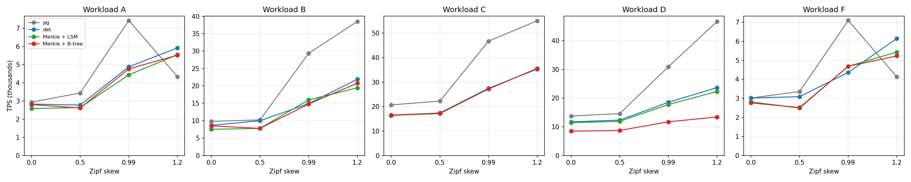
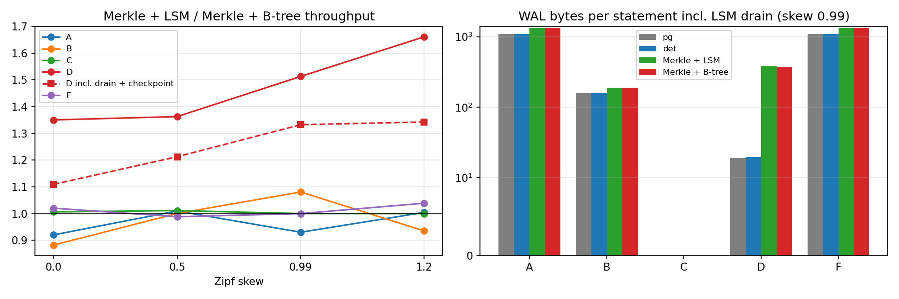

# OOM 100M YCSB matrix — A, B, C, D, F × 4 skews × 4 modes (2026-10-20/21)

80 runs, one trial each: workloads A, B, C, D, F; Zipf skew 0, 0.5, 0.99, 1.2; modes
pg, det (`bcdb_det`), Merkle with the `merkle_lsm` lookup index, Merkle with the B-tree
lookup index. All 80 passed; the matrix ran 2026-10-20 09:10 → 2026-10-21 07:36 UTC.

## Setup

- Source 5f2a078e, rebuilt for this campaign (`evidence/source_commit.txt`,
  `evidence/{pg,cpp}_binaries.sha256`). DB on 10.129.148.247, controller and gateway on 10.129.27.111.
- 100M rows, fillfactor 90, 2.4M statements per run, 16 workers, SERIALIZABLE,
  shared_buffers 32 MB, delta restore + cold OS cache + device settle before every run,
  pg with full-jitter client retry. Flags as in the 2026-10-19 D runs
  (`../../LSM_LOOKUP/merkle_lsm_ycsb_d_20261019/run_d.sh`), gateway timeout raised to 3600 s.
- Baselines: `base_ff90_plain` (pg, det), `base_ff90` (Merkle + B-tree lookup),
  `base_ff90_mlsm` (Merkle + `merkle_lsm`, 3 levels, L0 1 MiB, ratio 16). Unchanged during
  the campaign (control-file hashes checked before, during and after).
- Order: per workload d, c, b, a, f, each as three harness campaigns (plain, lsm, btree) over
  its four skews, so the four modes of one workload run within a few hours of each other.
  Every campaign spends ~300 s on device calibration, which is why combos were not split further.
- The four modes of every workload/skew ran the identical SQL file (same sha256).
- 1 Hz sampler (read committed, not a measured client) recorded commits, WAL LSN and
  `merkle_lsm_stats` per run. WAL "run only" = LSN before → after the run; WAL (full) adds the
  LSM drain (`merkle_lsm_flush`) and the post-run checkpoint.

## Audit

`harness/audit_merge.py` over all 80 runs: exact coverage, 2,400,000 validated statements per
run, SERIALIZABLE and 32 MB in the effective settings, 0 exhausted retries, 0 permanent
failures, 0 divergence, Merkle verify `t` in all 40 Merkle runs, LSM drain and merge state
present, WAL snapshots without a server restart, SQL sha256 parity across the four modes for
all 20 combos, sampler rows for every run with 0 errors in the measurement phase. No problems.

Retries occur only in pg (SSI, retried client-side): B/0.99 1,312; B/1.2 23,079; A/0.99
64,308; A/1.2 938,038; F/0.99 64,738; F/1.2 953,491. det and Merkle: 0 everywhere.

## Results

### TPS

| Workload | Skew | pg | det | Merkle + LSM | Merkle + B-tree | LSM / B-tree |
|---|---:|---:|---:|---:|---:|---:|
| A | 0.0 | 2,935 | 2,829 | 2,580 | 2,802 | 0.92 |
| A | 0.5 | 3,438 | 2,772 | 2,639 | 2,613 | 1.01 |
| A | 0.99 | 7,428 | 4,883 | 4,434 | 4,765 | 0.93 |
| A | 1.2 | 4,340 | 5,917 | 5,547 | 5,521 | 1.00 |
| B | 0.0 | 9,792 | 8,670 | 7,520 | 8,519 | 0.88 |
| B | 0.5 | 10,228 | 9,980 | 7,787 | 7,782 | 1.00 |
| B | 0.99 | 29,361 | 14,919 | 15,987 | 14,790 | 1.08 |
| B | 1.2 | 38,507 | 21,908 | 19,431 | 20,774 | 0.94 |
| C | 0.0 | 20,675 | 16,371 | 16,537 | 16,429 | 1.01 |
| C | 0.5 | 22,237 | 17,403 | 17,327 | 17,127 | 1.01 |
| C | 0.99 | 46,737 | 27,457 | 27,217 | 27,211 | 1.00 |
| C | 1.2 | 55,051 | 35,306 | 35,561 | 35,558 | 1.00 |
| D | 0.0 | 13,747 | 11,720 | 11,433 | 8,465 | 1.35 |
| D | 0.5 | 14,589 | 12,316 | 11,898 | 8,729 | 1.36 |
| D | 0.99 | 30,915 | 18,530 | 17,751 | 11,731 | 1.51 |
| D | 1.2 | 46,660 | 23,641 | 22,300 | 13,423 | 1.66 |
| F | 0.0 | 3,014 | 3,016 | 2,815 | 2,759 | 1.02 |
| F | 0.5 | 3,359 | 3,087 | 2,488 | 2,517 | 0.99 |
| F | 0.99 | 7,087 | 4,359 | 4,682 | 4,681 | 1.00 |
| F | 1.2 | 4,125 | 6,144 | 5,428 | 5,224 | 1.04 |

### WAL bytes per statement (run → after LSM drain and checkpoint)

| Workload | Skew | pg | det | Merkle + LSM (run only) | Merkle + LSM | Merkle + B-tree |
|---|---:|---:|---:|---:|---:|---:|
| A | 0.0 | 3,294 | 3,298 | 3,533 | 3,533 | 3,533 |
| A | 0.5 | 2,997 | 3,001 | 3,236 | 3,236 | 3,236 |
| A | 0.99 | 1,098 | 1,101 | 1,333 | 1,334 | 1,334 |
| A | 1.2 | 379 | 368 | 588 | 589 | 591 |
| B | 0.0 | 381 | 381 | 412 | 412 | 412 |
| B | 0.5 | 370 | 370 | 401 | 401 | 401 |
| B | 0.99 | 156 | 156 | 187 | 187 | 187 |
| B | 1.2 | 50 | 51 | 81 | 81 | 81 |
| C | 0.0 | 0 | 0 | 0 | 0 | 0 |
| C | 0.5 | 0 | 0 | 0 | 0 | 0 |
| C | 0.99 | 0 | 0 | 0 | 0 | 0 |
| C | 1.2 | 0 | 0 | 0 | 0 | 0 |
| D | 0.0 | 19 | 19 | 62 | 384 | 375 |
| D | 0.5 | 19 | 19 | 62 | 384 | 375 |
| D | 0.99 | 19 | 19 | 61 | 382 | 373 |
| D | 1.2 | 19 | 19 | 62 | 383 | 374 |
| F | 0.0 | 3,294 | 3,298 | 3,533 | 3,533 | 3,533 |
| F | 0.5 | 2,997 | 3,001 | 3,236 | 3,236 | 3,236 |
| F | 0.99 | 1,098 | 1,101 | 1,334 | 1,334 | 1,334 |
| F | 1.2 | 380 | 368 | 590 | 590 | 591 |

### Device read / write MiB during the run

| Workload | Skew | pg | det | Merkle + LSM | Merkle + B-tree |
|---|---:|---:|---:|---:|---:|
| A | 0.0 | 22,030 / 26,694 | 21,907 / 27,186 | 22,364 / 30,034 | 22,531 / 29,867 |
| A | 0.5 | 20,333 / 25,418 | 20,504 / 25,835 | 20,870 / 28,401 | 20,476 / 28,736 |
| A | 0.99 | 5,843 / 9,314 | 5,824 / 10,847 | 5,867 / 12,706 | 5,864 / 12,883 |
| A | 1.2 | 1,538 / 5,802 | 1,360 / 6,426 | 1,334 / 7,846 | 1,335 / 7,910 |
| B | 0.0 | 21,560 / 3,545 | 22,051 / 3,630 | 22,289 / 4,345 | 22,043 / 4,217 |
| B | 0.5 | 19,840 / 3,514 | 19,814 / 3,629 | 20,952 / 4,182 | 20,755 / 4,225 |
| B | 0.99 | 5,805 / 1,941 | 5,828 / 2,545 | 5,847 / 2,802 | 5,848 / 2,760 |
| B | 1.2 | 1,289 / 1,429 | 1,292 / 1,737 | 1,332 / 2,068 | 1,332 / 2,061 |
| C | 0.0 | 21,532 / 594 | 21,866 / 528 | 21,479 / 532 | 21,641 / 528 |
| C | 0.5 | 19,973 / 549 | 19,802 / 563 | 19,775 / 560 | 20,330 / 558 |
| C | 0.99 | 5,813 / 549 | 5,812 / 578 | 5,827 / 576 | 5,810 / 573 |
| C | 1.2 | 1,292 / 508 | 1,292 / 414 | 1,292 / 420 | 1,293 / 416 |
| D | 0.0 | 20,558 / 1,468 | 20,920 / 1,517 | 20,804 / 2,281 | 22,346 / 3,990 |
| D | 0.5 | 18,991 / 1,500 | 19,021 / 1,684 | 19,221 / 2,409 | 20,496 / 4,058 |
| D | 0.99 | 5,602 / 1,112 | 5,602 / 1,527 | 5,640 / 2,149 | 6,566 / 3,669 |
| D | 1.2 | 1,231 / 1,050 | 1,237 / 1,435 | 1,262 / 2,023 | 2,125 / 3,569 |
| F | 0.0 | 21,979 / 26,988 | 22,213 / 27,193 | 22,156 / 30,017 | 21,990 / 29,886 |
| F | 0.5 | 20,392 / 25,474 | 20,800 / 26,582 | 20,414 / 29,089 | 20,666 / 28,864 |
| F | 0.99 | 5,847 / 9,874 | 5,837 / 11,179 | 5,872 / 13,062 | 6,142 / 13,362 |
| F | 1.2 | 1,538 / 6,256 | 1,315 / 6,672 | 1,325 / 8,193 | 1,570 / 8,214 |

### Workload D: LSM gain with deferred merge work counted

| Skew | Gateway TPS LSM / B-tree | Gain | Run start → after drain and checkpoint, stmt/s LSM / B-tree | Gain | LSM drain s |
|---:|---:|---:|---:|---:|---:|
| 0.0 | 11,433 / 8,465 | +35% | 7,525 / 6,782 | +11% | 31.0 |
| 0.5 | 11,898 / 8,729 | +36% | 8,489 / 6,999 | +21% | 9.5 |
| 0.99 | 17,751 / 11,731 | +51% | 11,198 / 8,402 | +33% | 8.6 |
| 1.2 | 22,300 / 13,423 | +66% | 13,014 / 9,690 | +34% | 8.7 |

### LSM footprint during the run: max L0 / L1 component bytes (8,192 = empty metadata page)

| Workload | Skew 0 | 0.5 | 0.99 | 1.2 |
|---|---:|---:|---:|---:|
| A | 8,192 / 8,192 | 8,192 / 8,192 | 16,384 / 8,192 | 16,384 / 8,192 |
| B | 8,192 / 8,192 | 8,192 / 8,192 | 16,384 / 8,192 | 16,384 / 8,192 |
| C | 8,192 / 8,192 | 8,192 / 8,192 | 8,192 / 8,192 | 8,192 / 8,192 |
| D | 1,048,576 / 5,038,080 | 1,048,576 / 5,029,888 | 1,056,768 / 4,923,392 | 1,048,576 / 5,038,080 |
| F | 8,192 / 8,192 | 8,192 / 8,192 | 16,384 / 8,192 | 16,384 / 8,192 |

## Why `merkle_lsm` only helps workload D

The LSM replaces only the Merkle lookup index
`(merkle_partition_for_hash(merkle_key_hash(k),200), merkle_key_hash(k), k)`. That index
gets a new entry only when a row gets a new index entry: an INSERT, or an UPDATE that cannot be
HOT. Counted in the real SQL files (`harness/analysis/LSM_WORKLOAD_ANALYSIS.md`):

- D inserts ~120K new keys per run (100,000,001 upward). Each lands at a random position of the
  3 GB hash-ordered lookup index; with the B-tree that is a random leaf read and write in the
  foreground, with the LSM an append to the small L0. That is the whole D difference.
- A, B and F update FIELD1..FIELD10 only, never the key. With fillfactor 90 these updates are
  HOT-eligible, and the LSM footprint table shows the lookup index stayed empty during every
  A, B and F run (one page at skew ≥ 0.99), with identical WAL for LSM and B-tree. The lookup
  AM is irrelevant there; the remaining Merkle cost (full-row hash, leaf and ancestor node
  updates) is the same for both.
- C is read-only.

This is a property of YCSB (only D inserts), not a workload or harness bug. The HOT fraction
was not counted directly (no `n_tup_hot_upd` saved); the empty L0 is the evidence.

The D gain is partly deferred work. During the run the LSM writes ~1.7× less to the device
than the B-tree, but its L1→base merges happen in the post-run drain; through drain and
checkpoint, device writes are about equal and LSM WAL is slightly higher (~383 vs ~374 B/stmt).
Counting from run start to the end of the checkpoint the LSM gain is +11..+34% instead of
+35..+66%.

## Caveats

- One trial per case. Differences of ~10% between the two Merkle variants in A, B and F (e.g.
  B/0: LSM 7,520 vs B-tree 8,519; F/0.99: Merkle above det) are run-to-run variation, since
  those runs never touch the lookup index.
- D/0.99 Merkle + B-tree (11,731 TPS) is 10.4% below the 2026-10-19 result (13,091). A separate
  repeat right after the D group gave 13,176 TPS (`evidence/anchor_confirmation.json`); the
  original stays the official number.
- Device counters are for the whole partition (logs included). Run-only WAL for pg/det/B-tree
  equals full WAL; for the LSM, report the full figure.
- A and F (50% writes) are disk-bound: 25–30 GB written per run at skew ≤ 0.5, so they also
  make the next restore slower (up to ~11 min). Disk probes before each run stayed flat all
  night (`harness/analysis/DIAG_REPORT.md`).
- Generator differences from upstream YCSB: updates rewrite all 10 fields (20 chars each),
  integer keys with direct-rank Zipf (no hashing/scrambling), D's read-latest uses a static
  1,500-operation horizon, F is a single statement (`WITH ... MATERIALIZED` read + UPDATE).
- `result.json`'s `merkle_stats` is the pre-run baseline copy, not post-run (harness fixed
  after this campaign); Merkle correctness rests on the post-run `merkle_verify`.

## Files

- `summary.csv`: all 80 runs merged (TPS, wall, drain, run-to-checkpoint rate, WAL run/full,
  device I/O and await, retries, verify, LSM footprint and merges, reset/settle, SQL sha256,
  campaign and case path).
- `campaign/<workload>_<plain|lsm|btree>/run_*/`: per-run result/setup/io/checkpoint/WAL JSON,
  `merkle_verify.txt`, per-campaign summary, report and calibration; `campaign/status.txt`.
- `evidence/`: provenance hashes, anchor repeat, `sampler_per_case.json` (reduced sampler).
- `harness/`: `run_matrix.sh` (the controller as run), `audit_merge.py`, `plot_matrix.py`,
  `analysis/` (setup report, slowdown diagnosis, LSM workload analysis with evidence). The
  build and sampler scripts are in `scripts/distributed/ycsb_matrix_20261020/`.
- Not archived (on the hosts): workload SQL files, server/postgres/gateway logs and
  `telemetry.jsonl` in `.111:~/claude_ctl/ycsb_matrix_20261020/results/matrix/`; the raw sampler
  `.247:~/claude_checks/ycsb_matrix_20261020/evidence/wal_sampler.jsonl` (34 MB).
