# AriaBC Merkle implementation — a visual source guide

**Read against the local working tree on 2026-10-15.** HEAD: `a7fc519d`; includes existing uncommitted Merkle changes. Source walkthrough, not a new runtime validation.

| Scope | What this guide describes |
|---|---|
| Current working tree | Fanout up to **1024**, 10-bit splits with `uint16` child selectors, and a temporary candidate-table index in selective repair |
| Committed `a7fc519d` alone | Fanout validation up to **256**, 8-bit child selectors, and no temporary candidate-table index |
| Reading/reproducing | Use the accompanying working-tree changes; the guide does not assert those changes are already on main |

**Notation:** `h(row)` = BLAKE3-256 of the canonical full row; `+` / `−` = arithmetic modulo 2²⁵⁶. `N` = live row count. Diagrams use small illustrative trees; route bits and small numeric hashes are invented for teaching.

**Viewing:** All 59 diagrams are embedded PNG figures, styled after [the LSM architecture guide](LSM_LOOKUP_ARCHITECTURE.md): large labels, rounded boxes, consistent colours, clear arrows, and before/after panels. They display directly in a normal Markdown preview.

| Start here | Then explore |
|---|---|
| [Storage and nodes](#3-what-is-actually-stored-on-disk) | [All indexes](#7-every-index-involved-separate-their-jobs) |
| [Routing and hashes](#9-routing-hash-versus-row-hash) | [Insert](#12-insert-actual-callback-and-propagation), [delete](#13-delete-capture-before-deletion-stage-after-success), [update](#14-update-ordinary-sql-path-including-hot) |
| [Commit-time work](#17-commit-time-apply-two-levels-of-coalescing) | [Split](#21-split-an-oversized-bucket-becomes-an-internal-node), [merge](#22-merge-sibling-leaves-collapse-into-their-parent) |
| [Verification](#24-verification-what-the-current-function-actually-checks) | [Repair](#25-how-replica-repair-uses-these-structures-today), [source map](#29-source-map) |

## 1. The whole implementation in one picture

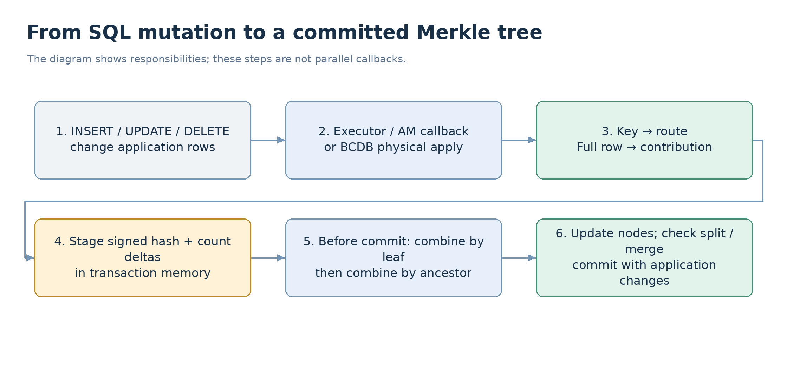

*Figure 1. From SQL mutation to a committed Merkle tree.*

Sources: [AM callbacks][S01], [staging][S05], [commit applier][S06].

## 2. One application table → a forest of partition trees

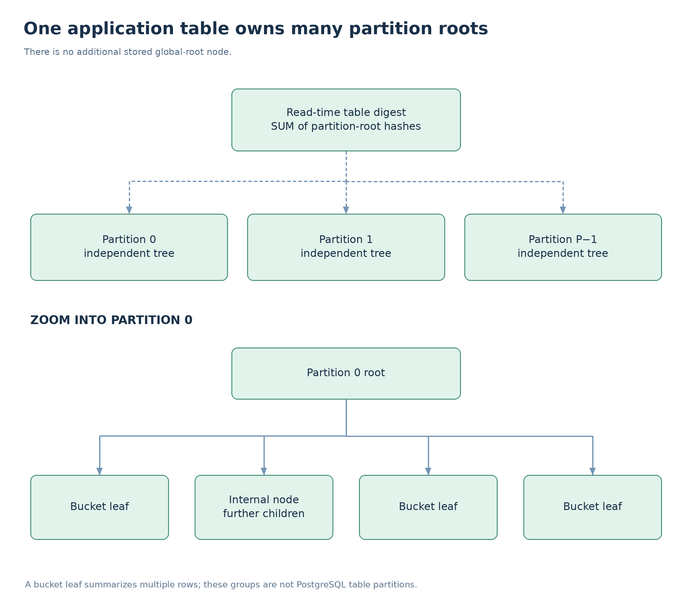

*Figure 2. One application table owns many partition roots.*

| Object | Meaning |
|---|---|
| Partition | Hash-selected logical group inside one application table; independent root |
| Internal node | Aggregate of its descendants |
| Leaf | Aggregate of **many application rows**, possibly zero |
| Table digest | Sum of root hashes; no additional stored global-root node |
| Tree shape | Adaptive; different partitions can have different depths |

These partitions are Merkle routing groups, not PostgreSQL table partitions. Sources: [build][S03], [root reader][S10].

## 3. What is actually stored on disk?

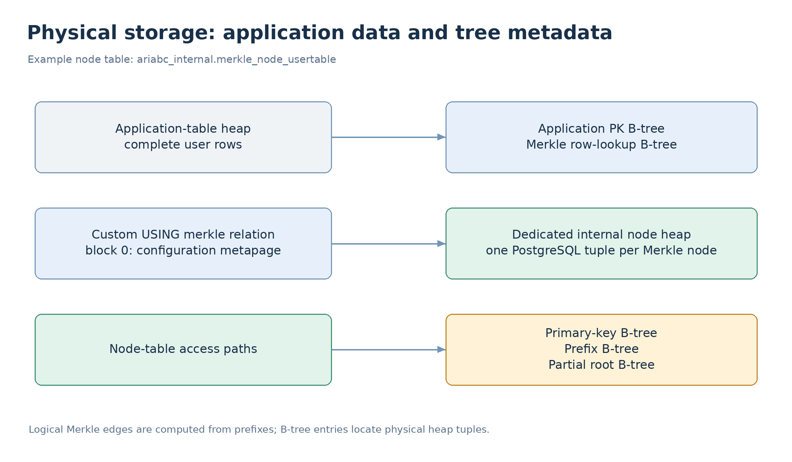

*Figure 3. Physical storage: application data and tree metadata.*

**The logical tree edges are computed from prefixes.** Node rows contain no child-pointer arrays, application-row lists, or per-row TIDs. Sources: [node table DDL][S04], [metapage][S11].

### Metapage: custom index block 0

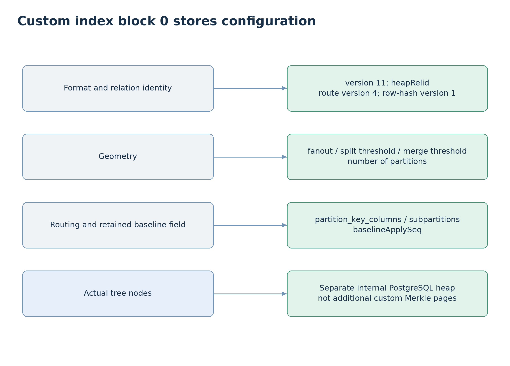

*Figure 4. Custom index block 0 stores configuration.*

Source: [MerkleMetaPageData][S12].

### Dedicated node-table names

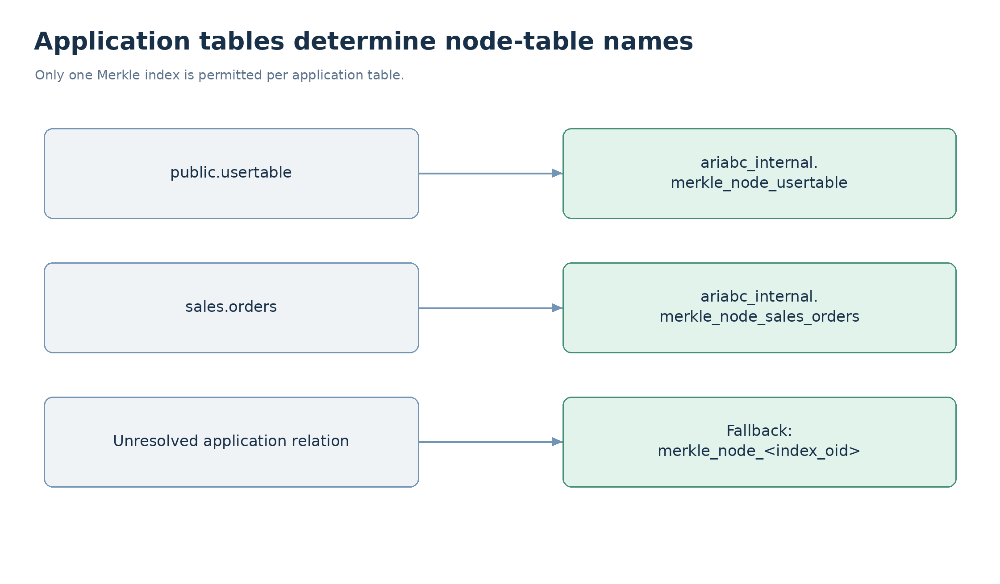

*Figure 5. Application tables determine node-table names.*

The builder permits **one Merkle index per application table**. Sources: [naming][S04], [build restrictions][S03].

## 4. A node is one six-column PostgreSQL tuple

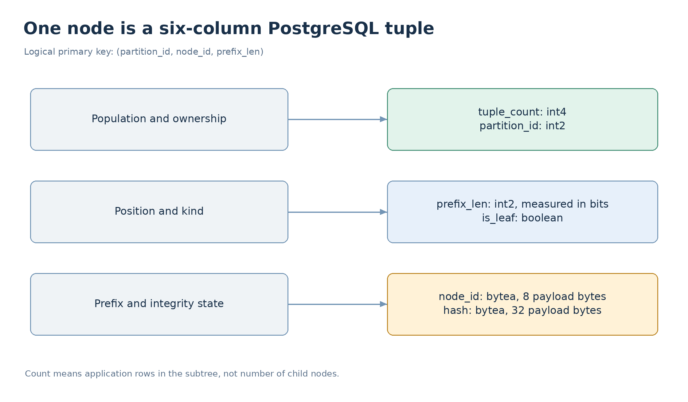

*Figure 6. One node is a six-column PostgreSQL tuple.*

| Column | What it represents |
|---|---|
| `tuple_count` | Number of live application rows in this node's subtree; not child count |
| `partition_id` | Which partition tree owns this node |
| `prefix_len` | Significant route bits in `node_id`; measured in **bits** |
| `is_leaf` | Whether traversal stops here |
| `node_id` | Route prefix, padded on the right with zero bits |
| `hash` | Sum of row contributions beneath the node |

Source: [actual CREATE TABLE][S04].

## 5. How node IDs encode the tree

**Fanout 4 → consume two route bits per level.**

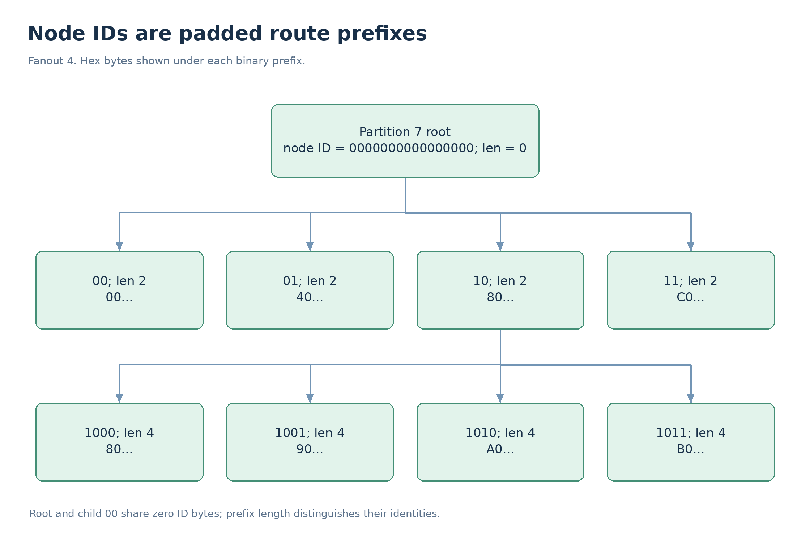

*Figure 7. Node IDs are padded route prefixes.*

Root and child `00` share zero-valued `node_id` bytes; **`prefix_len` distinguishes them**.

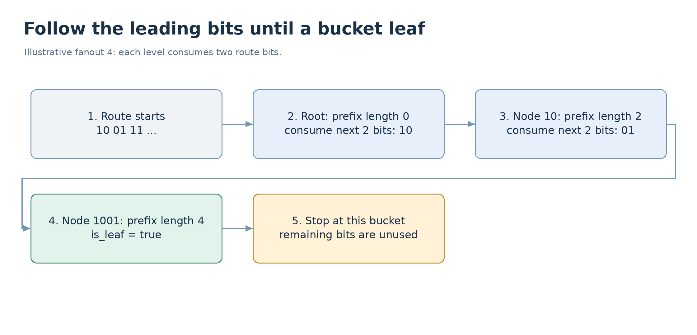

*Figure 8. Follow the leading bits until a bucket leaf.*

Sources: [`merkle_next_bits`, `merkle_bytea_extend`, `merkle_parent_of`][S13].

### Prefix = an inclusive byte range

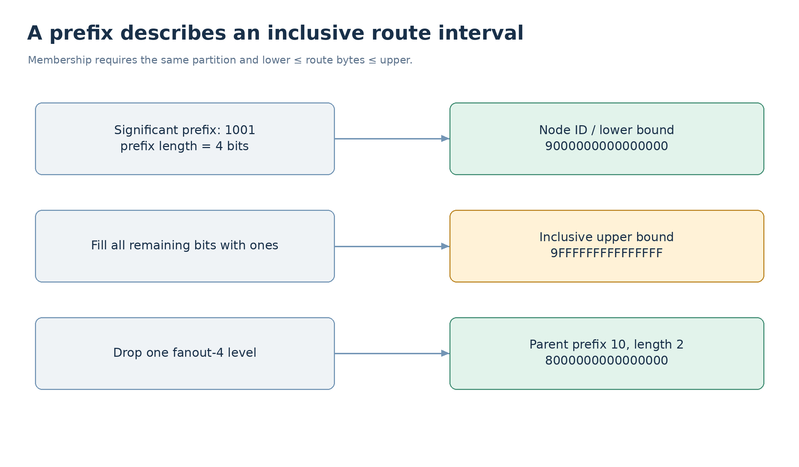

*Figure 9. A prefix describes an inclusive route interval.*

`bytea` route values are fixed-length, most-significant byte first; lexical range ordering matches these prefixes. Source: [bit helpers][S13].

## 6. Actual defaults versus benchmark settings

| Setting | Bare `USING merkle` in this working tree | OOM-100M YCSB and TPC-C benchmark setup |
|---|---:|---:|
| `fanout` | **4** | 32 |
| Route bits per split | 2 | 5 |
| `split_threshold` | **32** | 1024 |
| `merge_threshold` | **8** | 256 |
| `partitions` | 200 | 200 |
| `partition_key_columns` | 0 | 0 |
| `subpartitions` | 1 | 1 |

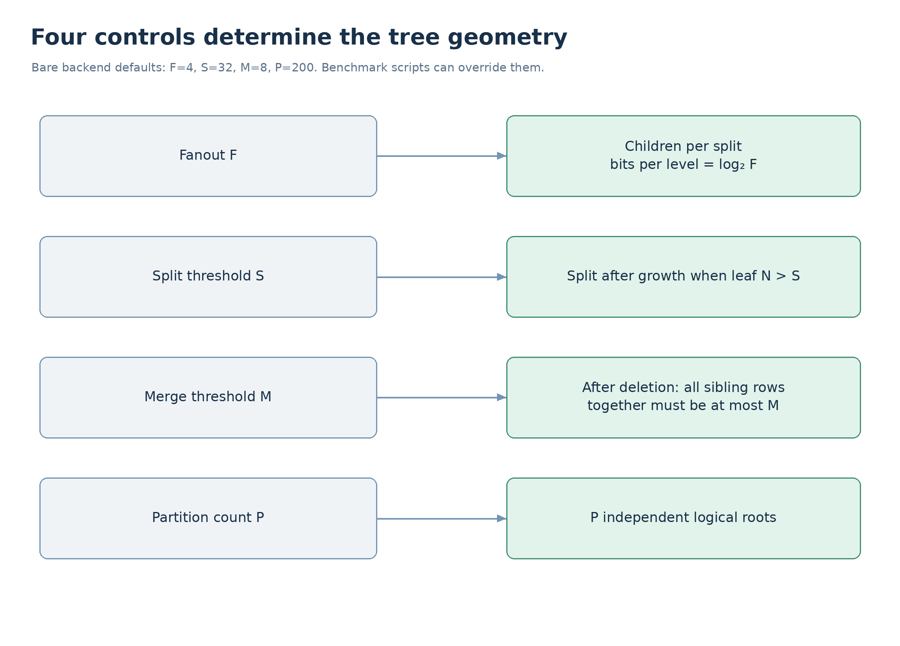

*Figure 10. Four controls determine the tree geometry.*

| Rule | Current implementation |
|---|---|
| Allowed fanouts | Powers of two from 2 through **1024** |
| Omitted split threshold | 1024 if fanout = 32; otherwise 32 |
| Omitted merge threshold | `max(1, split_threshold / 4)` |
| Threshold validation | `1 <= M < S`; `2 <= S <= 100000` |
| Partition limit | 1 through 32767 |
| Depth guard | Split only while the current prefix length is below 60; final child may reach 64 bits |

The TPC-C setup uses the same 32/1024/256 geometry by default (overridable through `bench_merkle_*` psql variables), while many small test SQL scripts use the bare 4/32/8 defaults. Sources: [constants][S12], [option resolution][S01], [OOM-100M DDL][S14], [TPC-C geometry][S32].

## 7. Every index involved: separate their jobs

| Index | Stored on | Key / predicate | Job | Created by |
|---|---|---|---|---|
| Application PK / query B-trees | Application table | Application keys | SQL lookups, uniqueness, ordinary queries | Schema/setup |
| `*_merkle_idx` | Application table | `USING merkle(key_columns)` | Register integrity maintenance; hold metapage | Explicit DDL/setup |
| `*_merkle_lookup_idx` | Application table | `(partition(route), route, key_columns...)` | Find actual rows inside a Merkle range | Benchmark/setup scripts |
| Node-table `*_pkey` | Internal node table | `(partition_id, node_id, prefix_len)` | Exact node lookup/update; uniqueness | Backend node-table creation |
| Node-table `*_prefix_idx` | Internal node table | `(partition_id, prefix_len, node_id)` | Same-level node range access | Backend node-table creation |
| Node-table `*_root_idx` | Internal node table | `(partition_id) WHERE prefix_len = 0` | Small root subset | Backend node-table creation |
| Repair temporary-table index | Temporary candidate rows | Application PK columns | Speed `NOT EXISTS` probes during repair | C++ repair routine |

The custom Merkle AM has `amgettuple = NULL`, `amgetbitmap = NULL`, `amcanunique = false`. Normal SQL searches use other indexes. Sources: [handler][S01], [node DDL][S04], [lookup setup][S14], [repair][S15].

### Three different questions → three different lookup paths

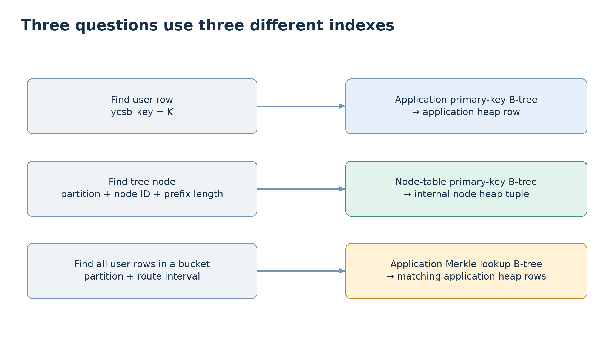

*Figure 11. Three questions use three different indexes.*

### Node primary-key B-tree: point lookup

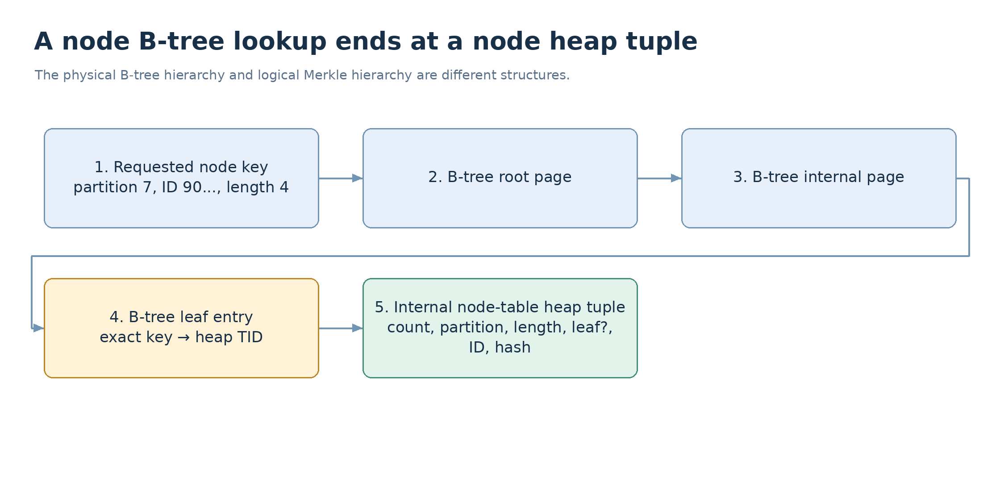

*Figure 12. A node B-tree lookup ends at a node heap tuple.*

The hot traversal explicitly opens the node table's primary-key index and calls `index_beginscan` with three equality keys. Source: [route resolver][S07].

### Why a second node B-tree changes column order

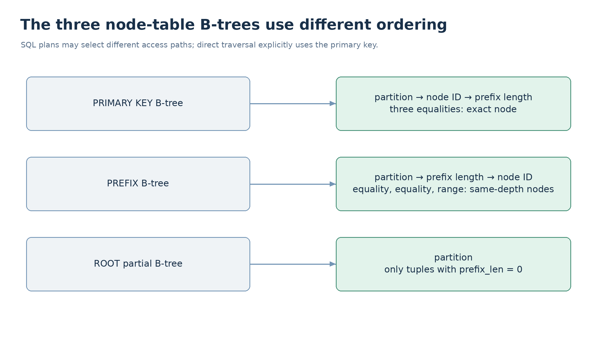

*Figure 13. The three node-table B-trees use different ordering.*

These are available access paths; SQL's planner decides whether a query uses them. Root scans without a selective partition condition may choose another plan. Sources: [DDL][S04], [merge query][S31], [root query][S10].

## 8. The application-table lookup index, in detail

Actual YCSB setup:

```sql
CREATE INDEX usertable_merkle_lookup_idx ON usertable (
    merkle_partition_for_hash(merkle_key_hash(ycsb_key), 200),
    merkle_key_hash(ycsb_key),
    ycsb_key
);
```

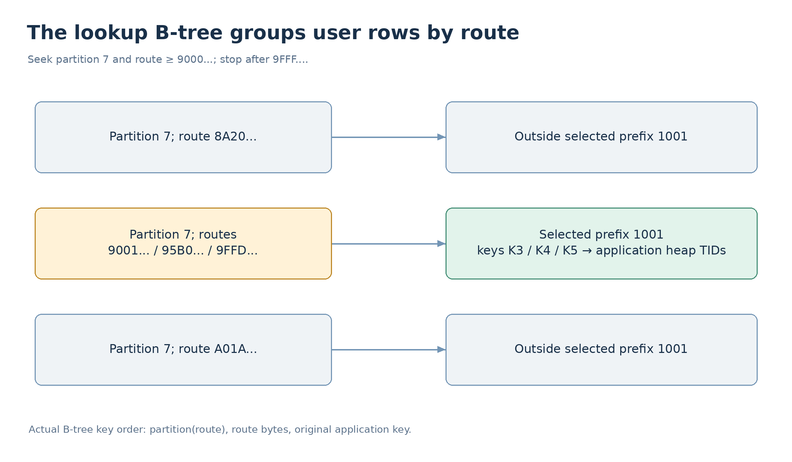

*Figure 14. The lookup B-tree groups user rows by route.*

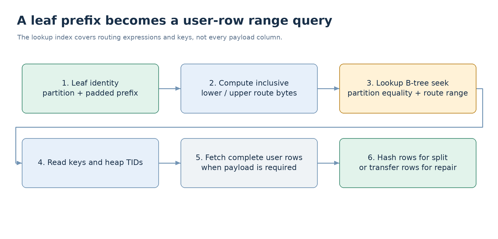

*Figure 15. A leaf prefix becomes a user-row range query.*

**Coverage:** this index contains routing expressions and keys. It does **not** contain every payload column; full-row hashing still needs application-row data. It is not automatically created by the custom AM. Missing it can make range queries expensive; the SQL planner may still choose a sequential scan. Sources: [setup][S14], [split SQL][S08].

## 9. Routing hash versus row hash

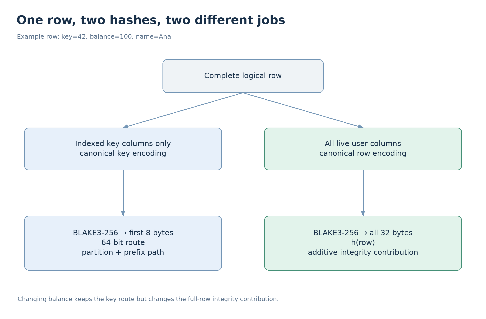

*Figure 16. One row, two hashes, two different jobs.*

| Change | Route | Row contribution |
|---|---|---|
| Change only a non-key payload | Same | Changes |
| Change an indexed key | Recomputed; may reach a different leaf/partition | Changes |
| Move a row physically / HOT version | Same logical key route | Based on user values, not physical position |
| Insert another identical row | Same route | Add the same contribution again; increment count |

`ctid` and `xmin` are not serialized as row fields. Sources: [canonical serializers][S02], [routing][S16].

### Canonical byte format

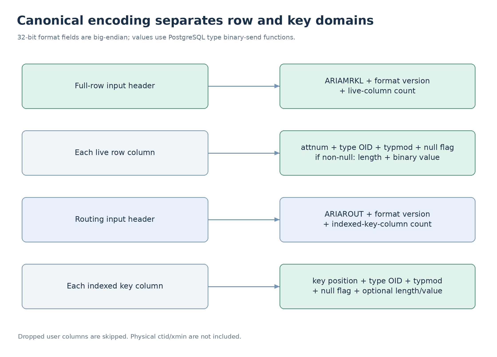

*Figure 17. Canonical encoding separates row and key domains.*

Schema/type descriptors participate in hashing; equivalent values under incompatible descriptors are not promised equal hashes. Source: [serialization][S02].

## 10. Composite keys and leading-key partition groups

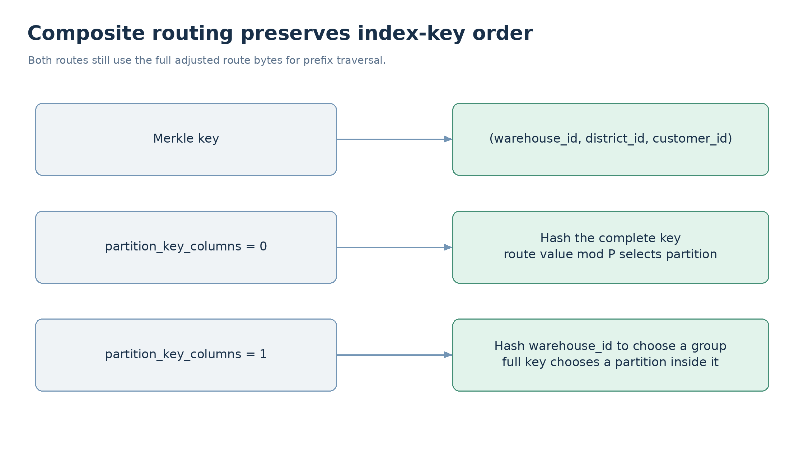

*Figure 18. Composite routing preserves index-key order.*

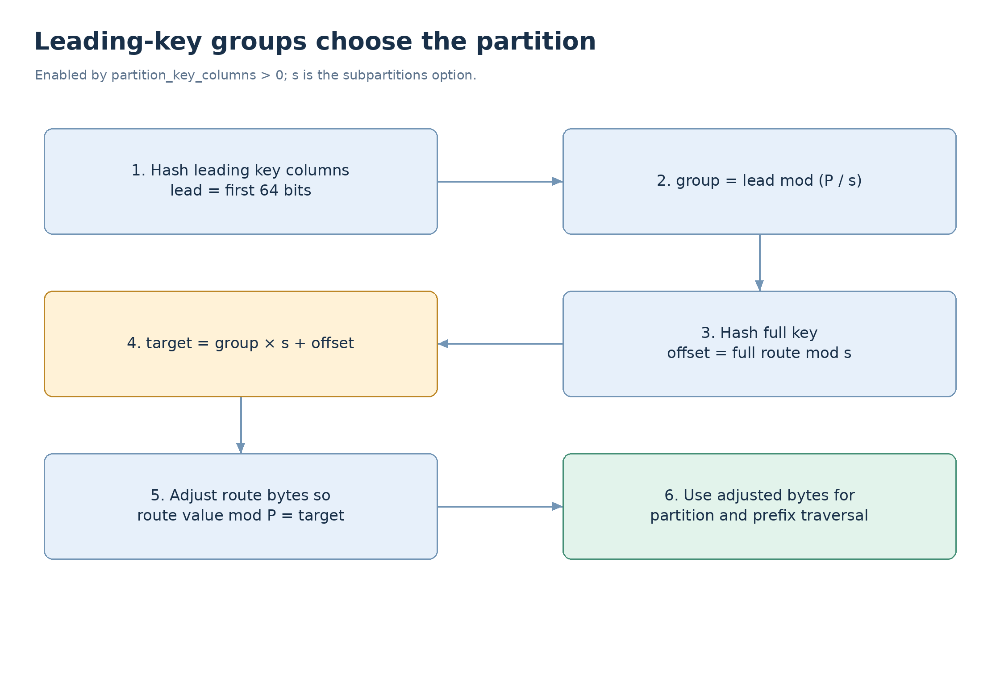

*Figure 19. Leading-key groups choose the partition.*

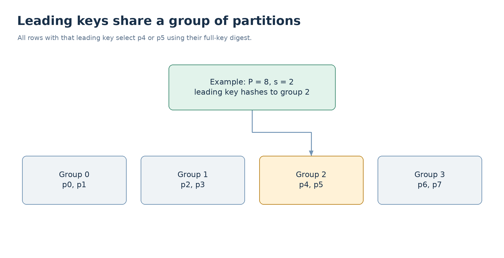

*Figure 20. Leading keys share a group of partitions.*

Lookup expressions must match this routing: `merkle_key_hash_routed(ROW(full_keys...), ROW(leading_keys...), P, s)`. TPC-C setup derives them from each Merkle index's catalog options. Sources: [routing arithmetic][S16], [TPC-C lookup generation][S17].

## 11. What a hash stored in a node means

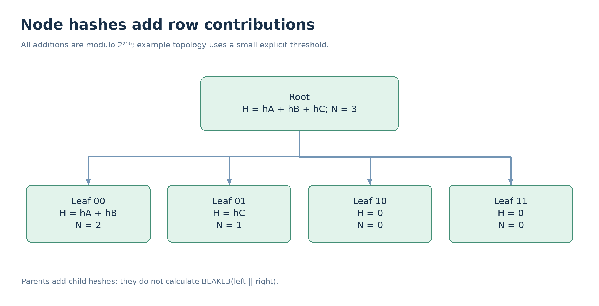

*Figure 21. Node hashes add row contributions.*

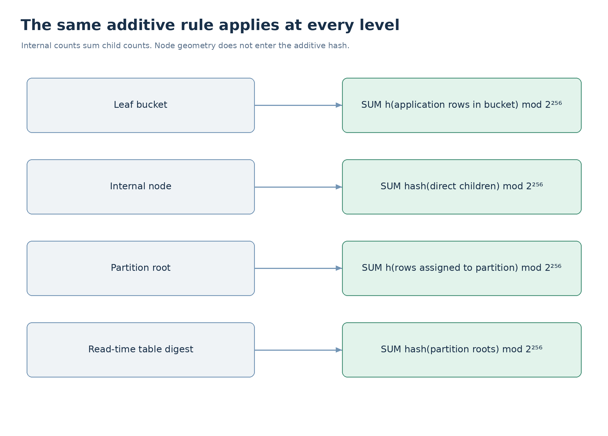

*Figure 22. The same additive rule applies at every level.*

**Historical names:** `merkle_hash_xor`, `xor_delta`, and some `*_xor_hash` variables now mean additive accumulation. Addition treats the 32 bytes as a **little-endian** integer; route integers use **big-endian** bytes. Source: [AdHash implementation][S02].

### The operation rules

| Operation | Hash delta | Count delta |
|---|---|---:|
| INSERT | `+h(new)` | +1 |
| DELETE | `−h(old)` | −1 |
| UPDATE staying in a leaf | `h(new) − h(old)` | 0 |
| UPDATE moving between leaves | Old leaf `−h(old)`; new leaf `+h(new)` | −1 / +1 |

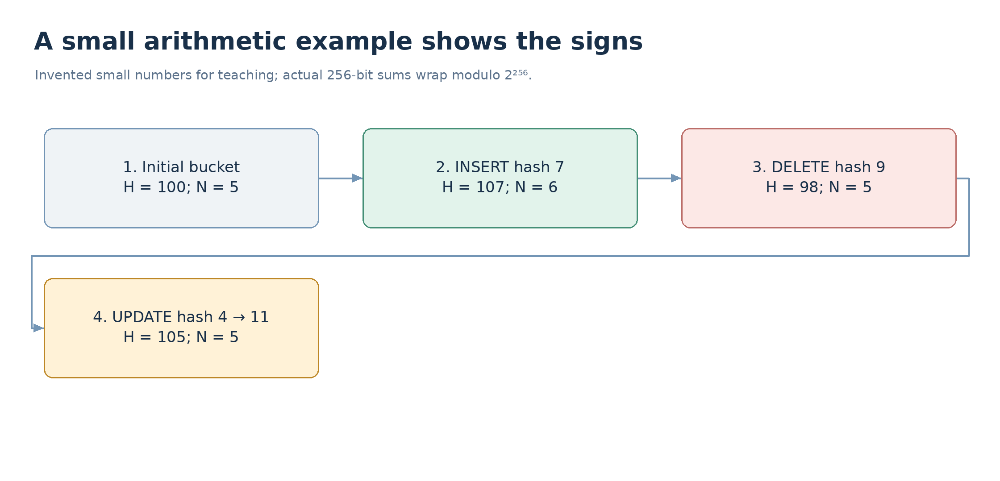

*Figure 23. A small arithmetic example shows the signs.*

## 12. INSERT: actual callback and propagation

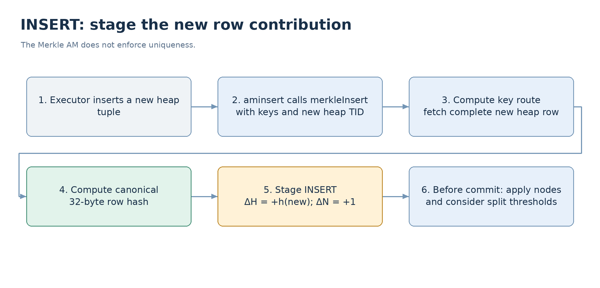

*Figure 24. INSERT: stage the new row contribution.*

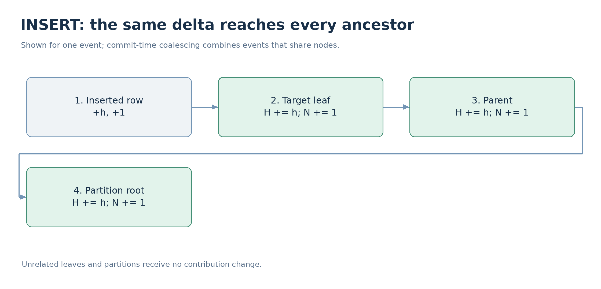

*Figure 25. INSERT: the same delta reaches every ancestor.*

No uniqueness check is provided by this AM. Source: [`merkleInsert`][S18].

## 13. DELETE: capture before deletion, stage after success

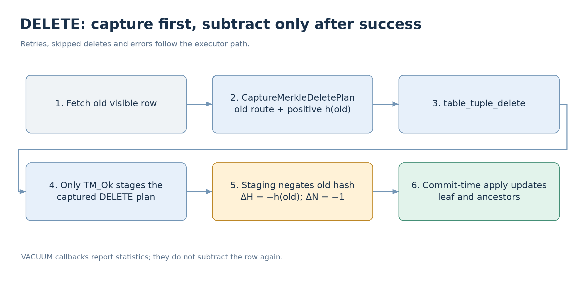

*Figure 26. DELETE: capture first, subtract only after success.*

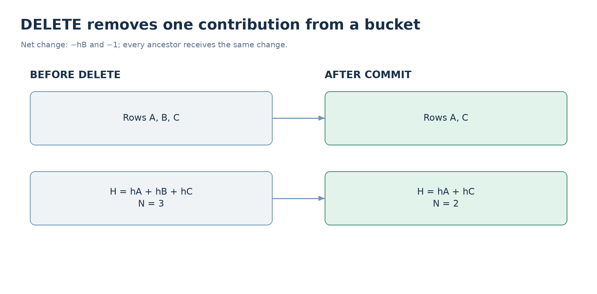

*Figure 27. DELETE removes one contribution from a bucket.*

`merkleBulkdelete` and `merkleVacuumcleanup` are statistics callbacks. VACUUM does not perform the logical subtraction again. Sources: [delete capture/apply][S19], [successful delete][S20], [VACUUM callbacks][S18].

## 14. UPDATE: ordinary SQL path, including HOT

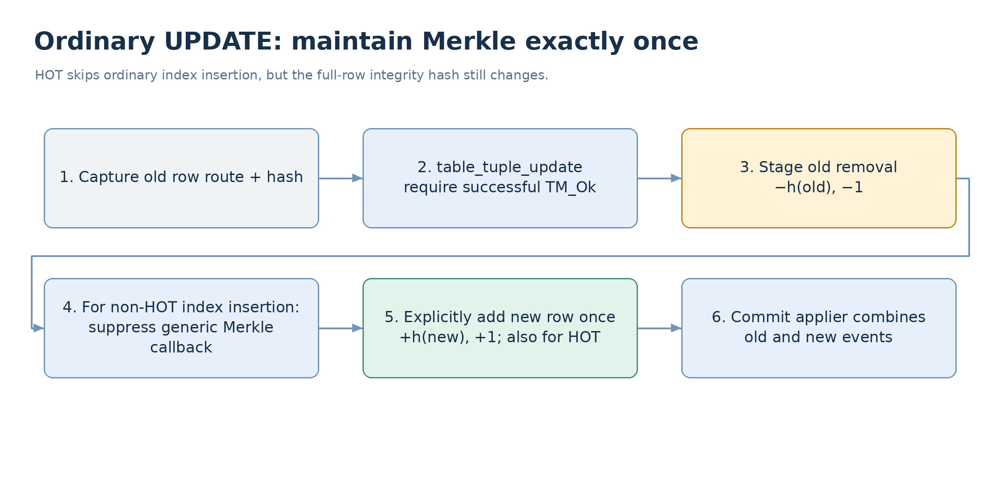

*Figure 28. Ordinary UPDATE: maintain Merkle exactly once.*

**Why explicit hooks?** A payload-only HOT update can skip ordinary index insertion, yet changes the full-row integrity contribution. Source: [ordinary update hooks][S21].

### Same leaf: count cancels, hash changes

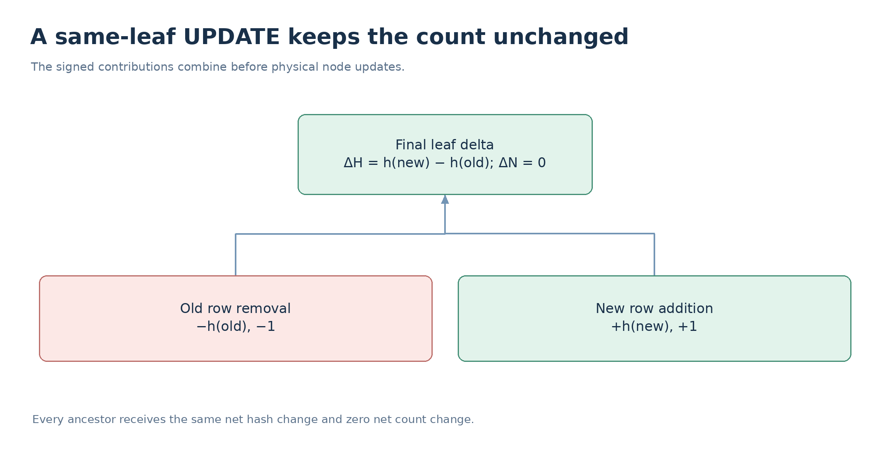

*Figure 29. A same-leaf UPDATE keeps the count unchanged.*

### BCDB shortcut: equality of 8 route bytes

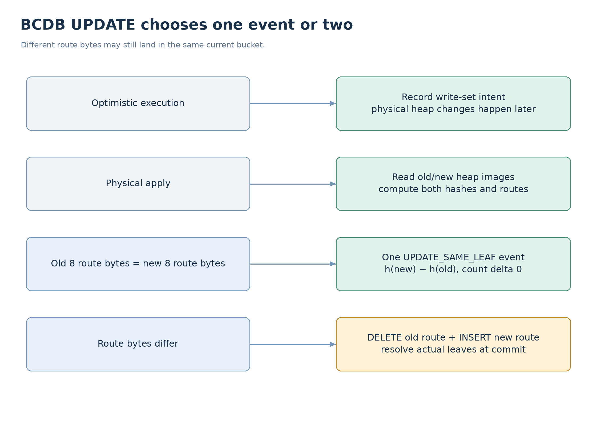

*Figure 30. BCDB UPDATE chooses one event or two.*

Different route bytes can still fall into the same current leaf; the commit applier combines them there. The enum's `SAME_LEAF` shortcut tests route-byte equality, not a precomputed leaf ID. Source: [BCDB update][S22].

### Exactly when the node applier runs

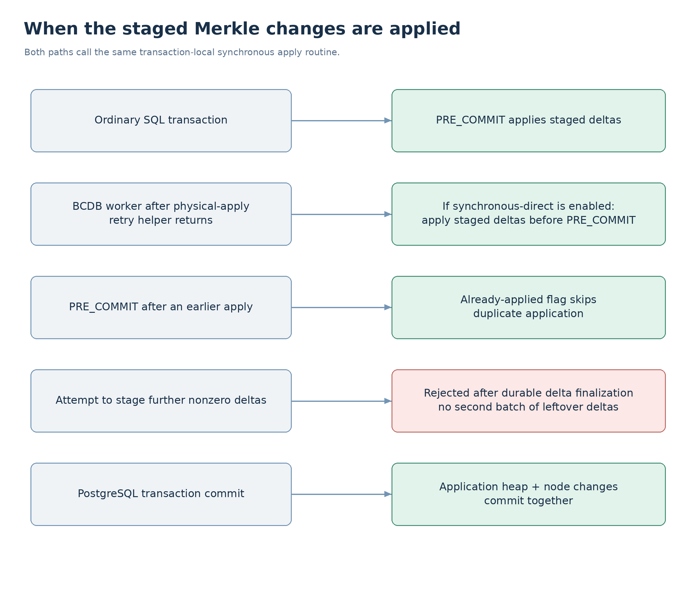

*Figure 31. When the staged Merkle changes are applied.*

Both calls use the same routine. For a transaction with staged deltas, PRE_COMMIT applies them **only if no earlier apply finalized them**; otherwise it skips. An earlier worker apply sets `merkle_staged_delta_persisted`, and subsequent attempts to stage nonzero Merkle changes raise *"Merkle data changes are not allowed after durable delta finalization"*. There is no second batch of leftover deltas. Current ledger terminalization sets its Merkle delta blob to NULL. Sources: [worker][S28], [staging guard][S05], [synchronous apply][S23], [PRE_COMMIT callback][S30], [ledger terminalization][S29].

## 15. UPDATE moving a key: two paths through the tree

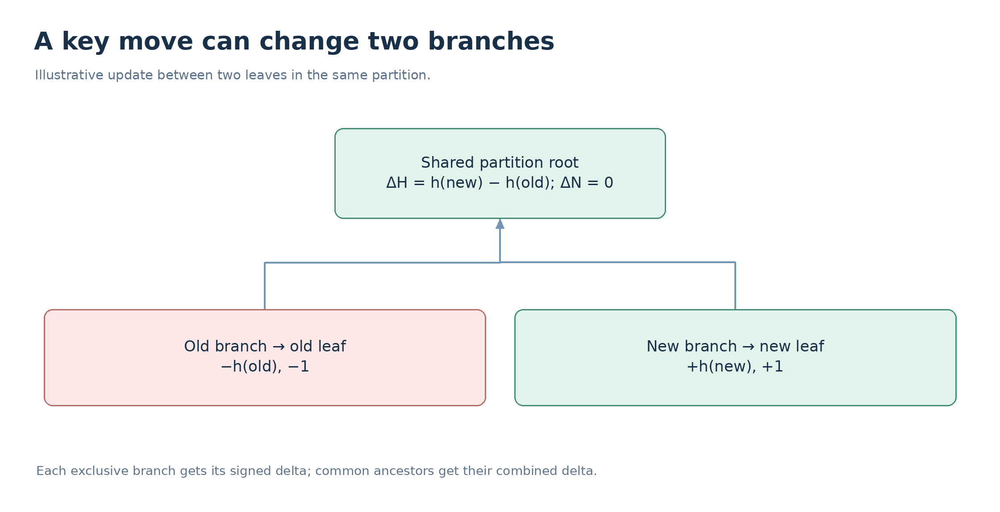

*Figure 32. A key move can change two branches.*

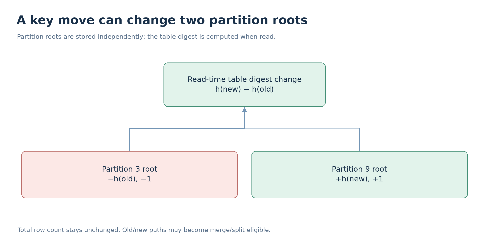

*Figure 33. A key move can change two partition roots.*

Old branch may become merge-eligible; new branch may become split-eligible. Sources: [staging][S05], [applier][S06].

## 16. Transaction-local staging: what is held in memory?

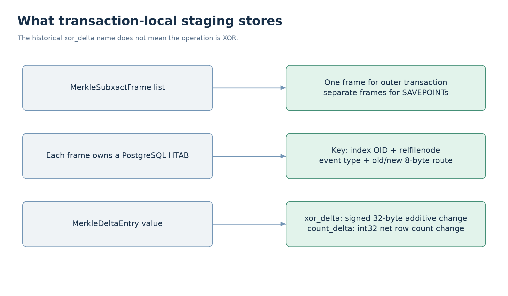

*Figure 34. What transaction-local staging stores.*

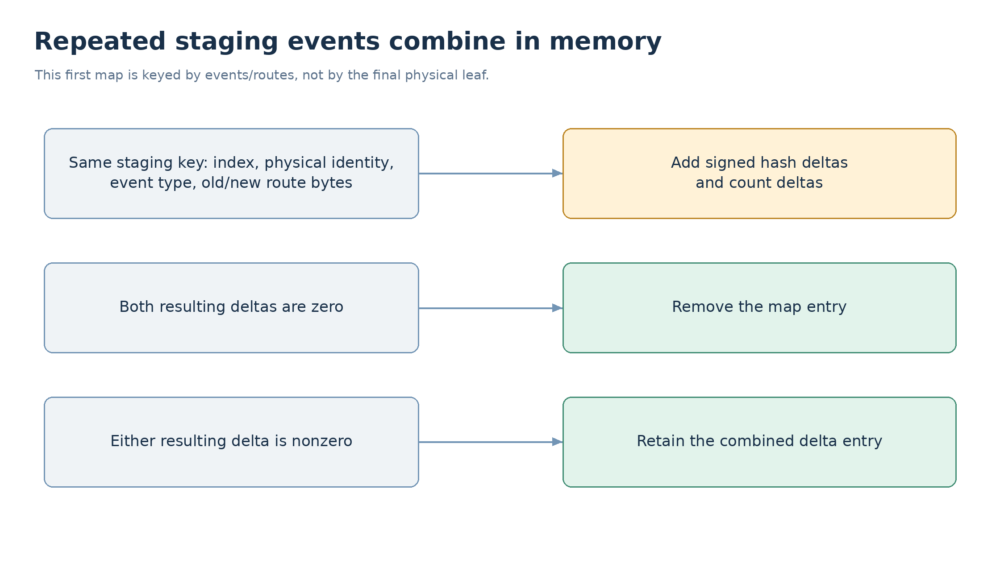

*Figure 35. Repeated staging events combine in memory.*

First-stage keys include event type and route bytes; this is not yet a map keyed by the final physical leaf. Source: [delta staging][S05].

### SAVEPOINT and rollback

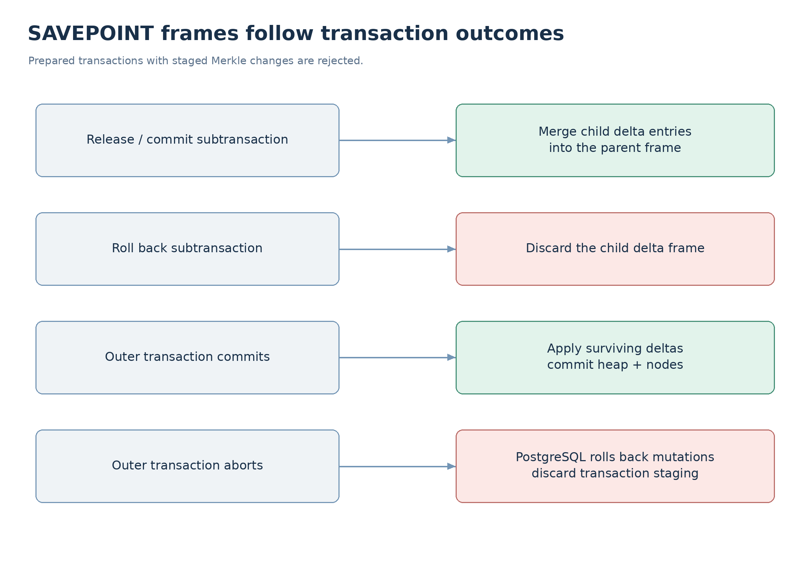

*Figure 36. SAVEPOINT frames follow transaction outcomes.*

Prepared transactions with staged Merkle changes are rejected. Sources: [transaction callback][S30], [subtransaction callback][S40].

## 17. Commit-time apply: two levels of coalescing

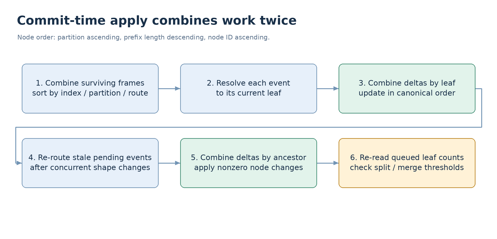

*Figure 37. Commit-time apply combines work twice.*

### Several writes sharing one ancestor

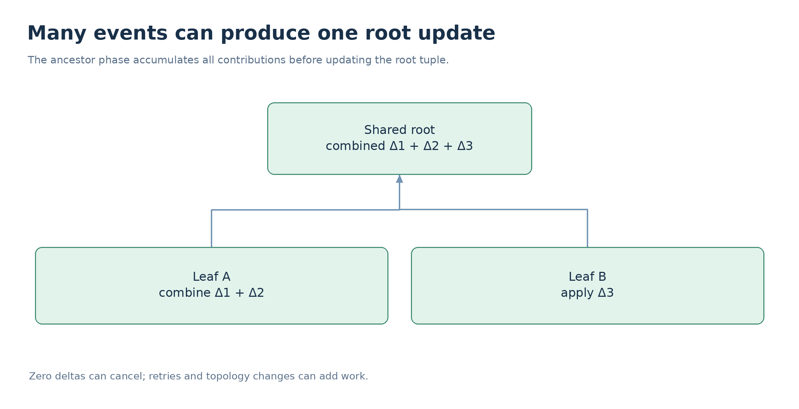

*Figure 38. Many events can produce one root update.*

**Work tracks distinct touched nodes**, after coalescing. Retries and topology changes can add work; it is not necessarily one physical write for the whole transaction. Source: [three-phase apply][S06].

## 18. Finding a leaf: cache → prefix traversal → node B-tree

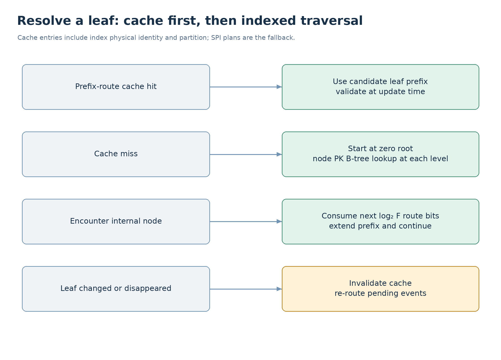

*Figure 39. Resolve a leaf: cache first, then indexed traversal.*

| Cache/hint | Contents | Lifetime / trust |
|---|---|---|
| Prefix-route cache | Index OID/relfilenode, partition, leaf prefix | 65536 backend-local slots; validated by update path |
| Metadata caches | Fanout, thresholds, partition/routing settings | Avoid repeated metapage reads |
| Route TID hints | Physical node tuples encountered during traversal | Checked against visible tuple and full node key |
| SPI plan cache | Prepared route/update/split queries | Reused while valid |
| Type-send cache | Binary serializers | Reuses resolved type functions |

These caches are memory accelerators, not additional durable indexes. Source: [route/cache machinery][S07].

## 19. Updating a physical node tuple: direct path and HOT

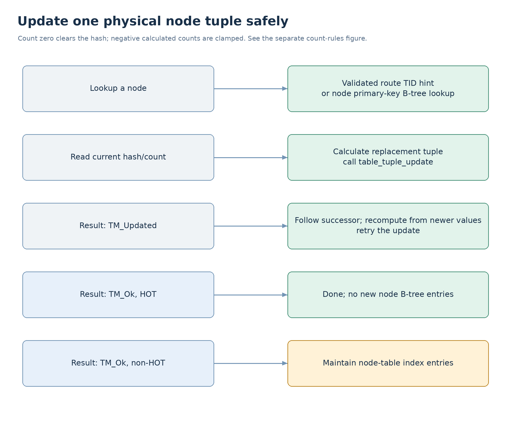

*Figure 40. Update one physical node tuple safely.*

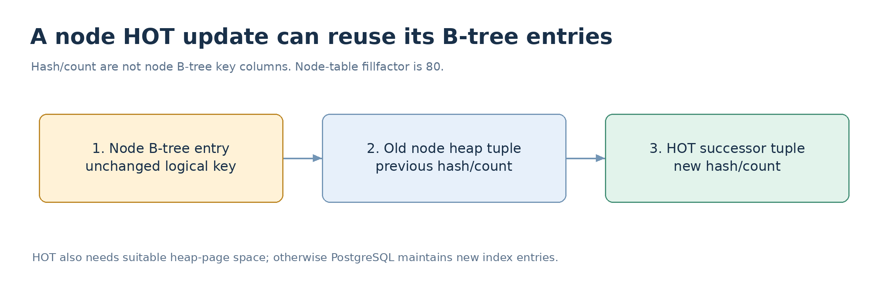

*Figure 41. A node HOT update can reuse its B-tree entries.*

The direct path uses PostgreSQL heap/MVCC/WAL machinery; this is not a raw in-place overwrite of a standalone Merkle file. SPI update plans remain a fallback.

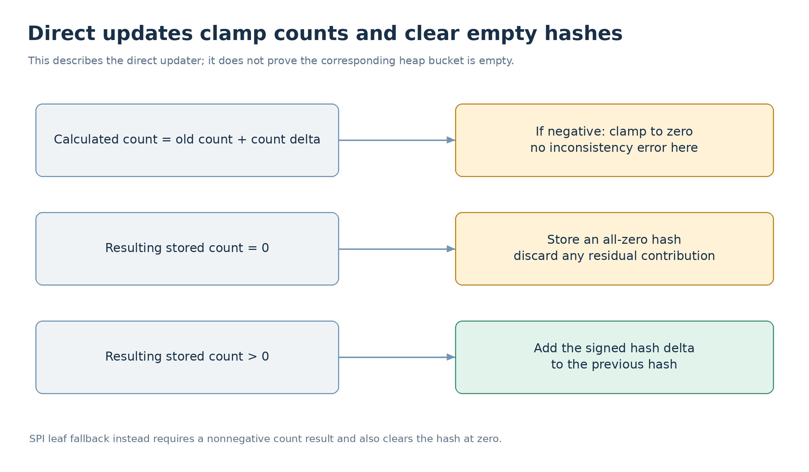

*Figure 42. Direct updates clamp counts and clear empty hashes.*

**The direct path does not reject a negative calculated count:** it clamps it to zero. Whenever the resulting count is zero, it also stores an all-zero hash instead of preserving any residual contribution. This can mask inconsistent input; it does not demonstrate that the heap bucket is actually empty. Source: [count/hash calculation][S33].

## 20. Concurrency around tree changes

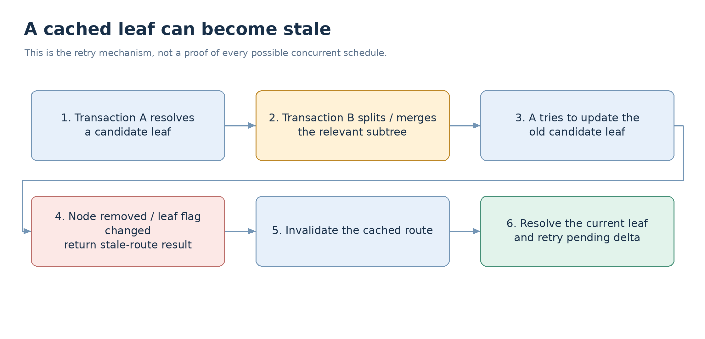

*Figure 43. A cached leaf can become stale.*

| Mechanism | Purpose in the code |
|---|---|
| Registered traversal snapshot | Keep traversed tuple versions protected during traversal |
| Canonical node ordering | Consistent order for leaf/ancestor updates |
| PostgreSQL tuple locks | Serialize updates to the same node tuple |
| Recompute after `TM_Updated` | Add delta to the newer committed contribution |
| Advisory transaction lock for shape checks | Guard split/merge work |
| `FOR UPDATE SKIP LOCKED` on merge siblings | Skip optional merge when another transaction holds a sibling |
| Internal maintenance wrapper | Switch to trusted backend identity; temporarily use read-committed behavior for internal updates; restore caller context |

This describes mechanisms, not a claim that every concurrent schedule has been proved correct. Sources: [route traversal][S07], [direct update][S09], [merge][S31], [trusted apply wrapper][S06].

## 21. Split: an oversized bucket becomes an internal node

**Teaching example:** fanout 4, explicit split threshold 4, merge threshold 1.

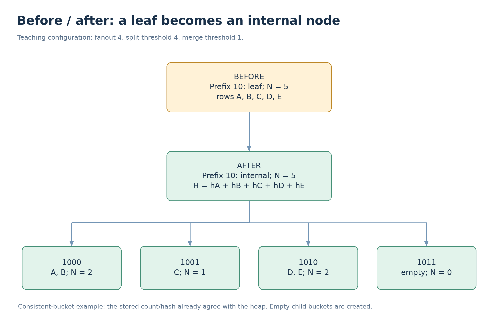

*Figure 44. Before / after: a leaf becomes an internal node.*

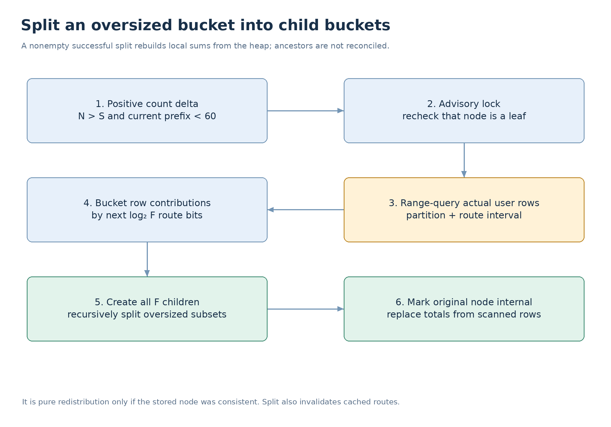

*Figure 45. Split an oversized bucket into child buckets.*

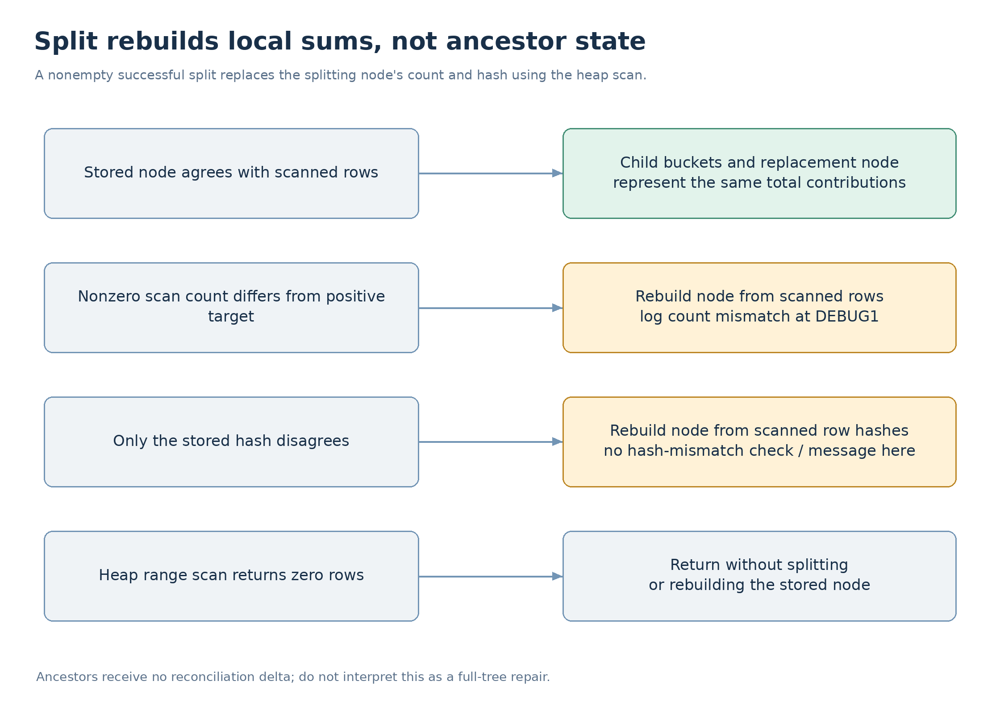

*Figure 46. Split rebuilds local sums, not ancestor state.*

A successful nonempty split **recomputes child hashes/counts and the splitting node from the heap scan**. Ancestors receive no reconciliation delta. Thus it is pure redistribution only when the stored node already agrees with those rows. A positive target count differing from a nonzero scan count logs `DEBUG1`; a hash-only disagreement has no corresponding check. A zero-row scan returns without rebuilding the node. Sources: [split retrieval][S08], [heap-derived node rewrite][S41], [count mismatch condition][S34].

### Fanout changes how many bits and children a split creates

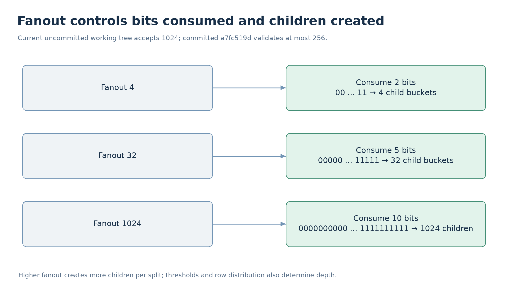

*Figure 47. Fanout controls bits consumed and children created.*

## 22. Merge: sibling leaves collapse into their parent

**Teaching example:** fanout 4, explicit merge threshold 3, split threshold greater than 3.

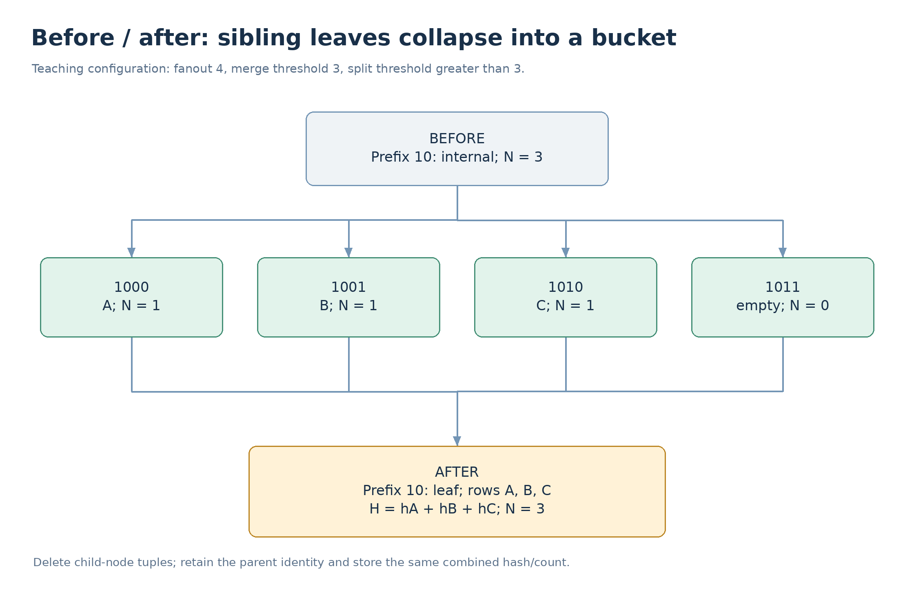

*Figure 48. Before / after: sibling leaves collapse into a bucket.*

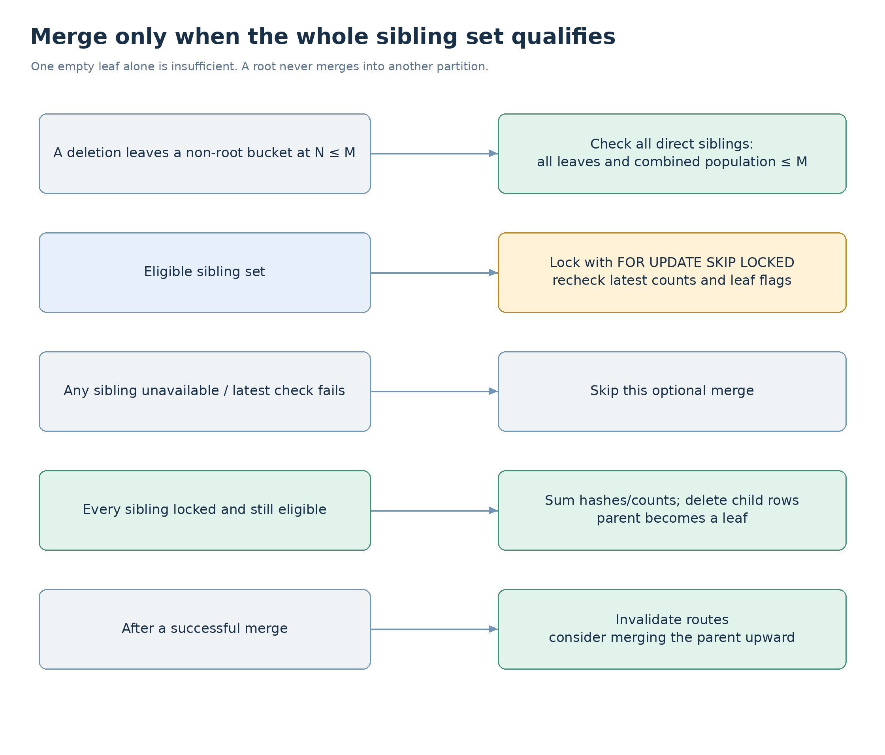

*Figure 49. Merge only when the whole sibling set qualifies.*

**One nearly empty leaf is insufficient:** the code checks the combined sibling population. A root can become a leaf, but is not merged into another partition. Source: [`do_merge_check`][S31].

### Split/merge hysteresis means shape can depend on history

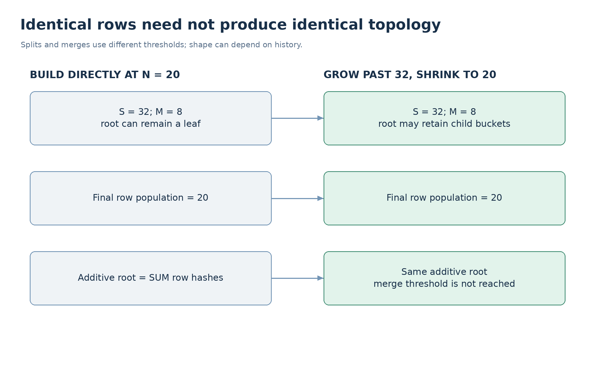

*Figure 50. Identical rows need not produce identical topology.*

Sources: [build rule][S03], [merge rule][S31].

## 23. Initial CREATE INDEX / REINDEX builds the tree in bulk


*Figure 51. CREATE INDEX / REINDEX builds nodes in bulk.*

| Build boundary | Current behavior |
|---|---|
| Permanent logged table | Required |
| Merkle indexes per application table | One |
| Composite key columns | Supported |
| Expression Merkle indexes | Rejected |
| Partial Merkle indexes | Rejected |
| Concurrent create/reindex | Rejected |
| Earlier staged DML in same transaction | Build/reindex rejected |
| Non-READY recovery status / pending committed deltas | Rejection branch exists, with an exception for caught-up INVALID/REBUILD_REQUIRED state; **currently inactive because the status helper always returns READY** |

The application lookup B-tree is separate setup. Initial bulk build scans the heap; split operations later use range SQL. The staged-DML restriction is active; the pending-committed-delta branch must be read together with the current READY stub. Sources: [`merkleBuild`][S03], [recovery-state build guard][S35], [status helper][S27].

## 24. Verification: what the current function actually checks


*Figure 52. What merkle_verify_index actually checks.*


*Figure 53. Verification has a precise boundary.*

A global sum plus internal consistency is narrower than a full independent routed-leaf reconstruction. Some source comments describe a stronger verification procedure than the actual function body. Source: [`merkle_verify_index`][S10].

## 25. How replica repair uses these structures today


*Figure 54. Replica repair: roots → leaf ranges → actual rows.*

**This C++ repair path compares partition roots, then leaf sets.** It does not recursively request child hashes level by level. Candidate ranges can include rows that are already correct; upsert checks avoid needless value updates. Sources: [`read_leaves` and range predicates][S15], [`repair_merkle_table`][S25].


*Figure 55. A differing leaf identifies a user-row route range.*

Current selective discovery requires **all three**: one Merkle key column, an existing node table, and an application primary-key constraint (`pg_index.indisprimary`). Generic backend hashing supports composite keys more broadly. Sources: [discovery SQL][S44], [eligibility condition][S36].


*Figure 56. Repair decisions choose rows, partitions, or a full copy.*

| Condition | Actual path |
|---|---|
| Ineligible table, present locally | Whole-table checksum; **copy only if checksums differ** |
| Roots match and heap verification is disabled or passes | No repair |
| Roots match but enabled heap verification fails | Full-table copy |
| Roots differ and leaf ranges differ | Selective repair of those ranges |
| Roots differ but no leaf range differs | Expand to **whole-partition ranges**, then use the same selective row-repair machinery |
| After selective repair: roots differ, or roots match but enabled heap verification fails | Full-table copy |

Ineligible reference tables absent locally are skipped by the current loop. Operational query/COPY failures can return an error; they are not all automatically converted into a full copy. The full-copy routine rebuilds local Merkle indexes in a separate transaction first, then performs `DELETE` + `COPY` and commits. Sources: [matching-root branch][S42], [whole-partition ranges][S37], [post-repair checks][S38], [checksum/skip dispatch][S39], [full-copy routine][S43].

## 26. TPC-C: Merkle keys and lookup families

| Application table | Indexed Merkle key columns, in order |
|---|---|
| `warehouse` | `w_id` |
| `district` | `d_w_id, d_id` |
| `customer` | `c_w_id, c_d_id, c_id` |
| `history` | `h_c_w_id, h_c_d_id, h_c_id` |
| `item` | `i_id` |
| `stock` | `s_w_id, s_i_id` |
| `oorder` | `o_w_id, o_d_id, o_id` |
| `new_order` | `no_w_id, no_d_id, no_o_id` |
| `order_line` | `ol_w_id, ol_d_id, ol_o_id, ol_number` |


*Figure 57. Each configured TPC-C table has the same families.*

`history`'s chosen Merkle key need not uniquely identify a history row: Merkle aggregates contributions and does not enforce uniqueness. Source: [TPC-C setup][S17].

<details>
<summary>Application query indexes explicitly created by the TPC-C setup</summary>

| Index | Columns |
|---|---|
| `pk_warehouse` | `w_id` |
| `pk_district` | `d_w_id, d_id` |
| `pk_customer` | `c_w_id, c_d_id, c_id` |
| `idx_customer_name_mid` | `c_w_id, c_d_id, c_last, c_first, c_id` |
| `pk_item` | `i_id` |
| `pk_stock` | `s_w_id, s_i_id` |
| `pk_oorder` | `o_w_id, o_d_id, o_id` |
| `idx_oorder_customer_latest` | `o_w_id, o_d_id, o_c_id, o_id DESC`; includes `o_entry_d, o_carrier_id` |
| `pk_new_order` | `no_w_id, no_d_id, no_o_id` |
| `pk_order_line` | `ol_w_id, ol_d_id, ol_o_id, ol_number` |

The `pk_*` entries here are `CREATE UNIQUE INDEX` statements; their names alone do not establish a PostgreSQL primary-key constraint. Source: [setup beginning][S26].

</details>


*Figure 58. The inspected TPC-C schema uses checksum-based repair.*

**For the inspected restore pipeline, none of the nine TPC-C tables qualifies for selective Merkle repair.** Seven Merkle keys are composite; `warehouse` and `item` have single-column keys but only unique indexes, without primary-key constraints. The loaded dump, scaling script and index setup add no PK constraints. Tables present locally therefore use whole-table checksums, with a full copy **only for a mismatch**. This conclusion is about that schema: manually adding constraints can change eligibility for the single-key tables. It is not a claim about a newly inspected running database or measured recovery time. Sources: [restore pipeline][S45], [application index DDL][S26], [loaded dump][S46], [scaling script][S47], [repair dispatch][S39].

## 27. Read helpers: implemented versus historical API names

| Helper | Current behavior relevant to this guide |
|---|---|
| `merkle_root_hash(table)` / `merkle_root_hash_index(index)` | Read sum of partition roots as hex |
| `merkle_verify(table)` / `merkle_verify_index(index)` | Heap/global aggregate + internal consistency checks |
| `merkle_tree_stats(table)` | Configuration and node geometry statistics |
| `merkle_get_partition_root_hash(es)` | Native partition-root reads |
| `merkle_key_hash(key)` | SQL route helper; returns first 8 digest bytes |
| `merkle_key_hash_routed(...)` | SQL route helper with leading-key grouping |
| `merkle_tuple_hash(row)` | Canonical full-row hash |
| `merkle_node_upper_bound(id, len)` | Inclusive prefix upper bound |
| `merkle_node_hash`, `merkle_leaf_tuples`, `merkle_leaf_id`, `merkle_bucket_for_key` | Bodies reject use for dynamic trees |
| `merkle_get_node_hash`, `merkle_get_child_hashes`, `merkle_get_node_hashes`, `merkle_get_children_batch`, `merkle_get_leaf_members` | Bodies reject use for dynamic trees |

```sql
-- Read examples; run only against the appropriate remote instance.
SELECT merkle_root_hash('usertable');
SELECT merkle_verify('usertable');
SELECT merkle_tree_stats('usertable');
```

Source: [verification/helper bodies][S10], [route helpers][S16].

## 28. Details that prevent the wrong mental picture

| Tempting interpretation | What this working tree does |
|---|---|
| Each row owns a Merkle leaf | Multiple rows share a prefix bucket |
| Merkle nodes are custom index pages | Nodes are separate PostgreSQL heap tuples |
| Parent hash concatenates child hashes | Parent adds child hashes modulo 2²⁵⁶ |
| `xor_delta` means XOR | Historical name for a signed additive delta |
| Merkle lookup index searches nodes | It searches application rows by route |
| Node prefix index drives normal traversal | Direct traversal explicitly uses the node PK B-tree |
| Every statement immediately writes the tree | It stages deltas; worker synchronous apply or PRE_COMMIT materializes them before commit |
| VACUUM performs logical DELETE maintenance | Executor/physical apply captures old rows and stages subtraction |
| Every UPDATE rewrites all node indexes | HOT node updates can avoid B-tree entry maintenance |
| `merkle_apply_until` proves asynchronous replay | Current body returns its argument; recovery status is hard-coded READY |
| Matching root proves exact leaf membership | Current verifier does not independently reconstruct routed leaves |
| Default fanout is 32 | Bare backend default is 4; cited benchmark explicitly selects 32 |

Sources: [AM][S01], [node DDL][S04], [apply][S06], [current freshness/status stubs][S27], [verification][S10].

Two implementation boundaries: `tuple_count` is stored as int4; the direct updater clamps negative calculated counts to zero and clears the hash at count zero, while the SPI leaf fallback rejects a negative result through its UPDATE predicate and also clears the hash at zero. Sources: [direct calculation][S33], [SPI update predicates][S48].

Root/localization readers reject staged changes in the current transaction: commit first, then read in a new transaction. Internal SQL tables are engine metadata; locating them in `ariabc_internal` alone does not establish protection against every database role. Sources: [freshness gate][S27], [trusted wrapper][S06].

## 29. Source map


*Figure 59. Where each responsibility lives in the source.*

<details>
<summary>Source links and inspection anchors</summary>

| Reference | File and main anchor |
|---|---|
| S01 | [merkle.c — options + handler][S01] |
| S02 | [merkleutil.c — arithmetic + serialization][S02] |
| S03 | [merklebuild.c — merkleBuild][S03] |
| S04 | [merkleutil.c — node naming + DDL][S04] |
| S05 | [merkledelta.c — staging][S05] |
| S06 | [merkleapply.c — main coalesced apply][S06] |
| S07 | [merkleapply.c — route resolver][S07] |
| S08 | [merkleapply.c — do_split / heap retrieval][S08] |
| S09 | [merkleapply.c — direct node update][S09] |
| S10 | [merkleverify.c — verifier + root read][S10] |
| S11 | [merkleutil.c — metapage initialization][S11] |
| S12 | [merkle.h — constants + structures][S12] |
| S13 | [merkle.h — bit helpers][S13] |
| S14 | [run_oom_100m_benchmark.py — index setup][S14] |
| S15 | [replica_repair.cxx — discovery + leaf/range access][S15] |
| S16 | [merkleutil.c — route calculation][S16] |
| S17 | [restore_tpcc_procs.sql — Merkle/index setup][S17] |
| S18 | [merkleinsert.c — aminsert and VACUUM][S18] |
| S19 | [nodeModifyTable.c — capture/apply delete plan][S19] |
| S20 | [nodeModifyTable.c — successful heap delete][S20] |
| S21 | [nodeModifyTable.c — ordinary UPDATE][S21] |
| S22 | [shm_transaction.c — BCDB UPDATE delta shortcut][S22] |
| S23 | [merkledelta.c — synchronous staged apply][S23] |
| S24 | [merkleapply.c — in-memory split][S24] |
| S25 | [replica_repair.cxx — repair_merkle_table][S25] |
| S26 | [restore_tpcc_procs.sql — application indexes][S26] |
| S27 | [merkleapply.c — current status/freshness helpers][S27] |
| S28 | [worker.c — synchronous apply after retry helper][S28] |
| S29 | [raft_apply_ledger.c — current terminalization][S29] |
| S30 | [merkledelta.c — transaction callback][S30] |
| S31 | [merkleapply.c — do_merge_check][S31] |
| S32 | [restore_tpcc_procs.sql — default geometry][S32] |
| S33 | [merkleapply.c — direct count/hash calculation][S33] |
| S34 | [merkleapply.c — count mismatch / empty scan][S34] |
| S35 | [merklebuild.c — recovery-state build guard][S35] |
| S36 | [replica_repair.cxx — selective eligibility][S36] |
| S37 | [replica_repair.cxx — whole-partition range fallback][S37] |
| S38 | [replica_repair.cxx — checks after selective repair][S38] |
| S39 | [replica_repair.cxx — checksum and skip dispatch][S39] |
| S40 | [merkledelta.c — subtransaction callback][S40] |
| S41 | [merkleapply.c — node rewrite from scanned rows][S41] |
| S42 | [replica_repair.cxx — matching-root / heap-verify branch][S42] |
| S43 | [replica_repair.cxx — full_table_copy][S43] |
| S44 | [replica_repair.cxx — primary-key discovery SQL][S44] |
| S45 | [run_all_modes_gateway_sweep.py — restore pipeline][S45] |
| S46 | [tpcc-pgdump-full.sql — loaded schema/data][S46] |
| S47 | [restore_tpcc_scale.py — scaling script][S47] |
| S48 | [merkleapply.c — SPI leaf/ancestor update plans][S48] |

Figure artwork is reproducible from [render.py](merkle_implementation_diagrams/render.py); [validate.py](merkle_implementation_diagrams/validate.py) checks the document, assets and reviewed source hashes.

**Evidence boundary:** [validation.json](merkle_implementation_diagrams/validation.json) checks artifact integrity, links and snapshot freshness. [source_review.json](merkle_implementation_diagrams/source_review.json) records the source-inspection findings and exact file hashes separately. Neither is build/database validation or a proof of all execution schedules.

Line anchors describe the inspected working tree and may move after edits. The document follows executable bodies where older comments disagree. No build, database, or benchmark was started for this documentation task.

</details>

[S01]: ../src/backend/access/merkle/merkle.c#L165
[S02]: ../src/backend/access/merkle/merkleutil.c#L322
[S03]: ../src/backend/access/merkle/merklebuild.c#L1540
[S04]: ../src/backend/access/merkle/merkleutil.c#L1588
[S05]: ../src/backend/access/merkle/merkledelta.c#L173
[S06]: ../src/backend/access/merkle/merkleapply.c#L2320
[S07]: ../src/backend/access/merkle/merkleapply.c#L1450
[S08]: ../src/backend/access/merkle/merkleapply.c#L620
[S09]: ../src/backend/access/merkle/merkleapply.c#L1981
[S10]: ../src/backend/access/merkle/merkleverify.c#L260
[S11]: ../src/backend/access/merkle/merkleutil.c#L1001
[S12]: ../src/include/access/merkle.h#L104
[S13]: ../src/include/access/merkle.h#L363
[S14]: ../scripts/distributed/run_oom_100m_benchmark.py#L378
[S15]: ../ariabc_pg/src/replica_repair.cxx#L144
[S16]: ../src/backend/access/merkle/merkleutil.c#L657
[S17]: ../scripts/restore_tpcc_procs.sql#L848
[S18]: ../src/backend/access/merkle/merkleinsert.c#L44
[S19]: ../src/backend/executor/nodeModifyTable.c#L184
[S20]: ../src/backend/executor/nodeModifyTable.c#L1298
[S21]: ../src/backend/executor/nodeModifyTable.c#L1952
[S22]: ../src/backend/bcdb/shm_transaction.c#L3315
[S23]: ../src/backend/access/merkle/merkledelta.c#L385
[S24]: ../src/backend/access/merkle/merkleapply.c#L448
[S25]: ../ariabc_pg/src/replica_repair.cxx#L476
[S26]: ../scripts/restore_tpcc_procs.sql#L8
[S27]: ../src/backend/access/merkle/merkleapply.c#L968
[S28]: ../src/backend/bcdb/worker.c#L3565
[S29]: ../src/backend/bcdb/raft_apply_ledger.c#L1329
[S30]: ../src/backend/access/merkle/merkledelta.c#L432
[S31]: ../src/backend/access/merkle/merkleapply.c#L751
[S32]: ../scripts/restore_tpcc_procs.sql#L768
[S33]: ../src/backend/access/merkle/merkleapply.c#L2124
[S34]: ../src/backend/access/merkle/merkleapply.c#L689
[S35]: ../src/backend/access/merkle/merklebuild.c#L1588
[S36]: ../ariabc_pg/src/replica_repair.cxx#L153
[S37]: ../ariabc_pg/src/replica_repair.cxx#L532
[S38]: ../ariabc_pg/src/replica_repair.cxx#L626
[S39]: ../ariabc_pg/src/replica_repair.cxx#L770
[S40]: ../src/backend/access/merkle/merkledelta.c#L472
[S41]: ../src/backend/access/merkle/merkleapply.c#L602
[S42]: ../ariabc_pg/src/replica_repair.cxx#L493
[S43]: ../ariabc_pg/src/replica_repair.cxx#L440
[S44]: ../ariabc_pg/src/replica_repair.cxx#L124
[S45]: ../scripts/distributed/run_all_modes_gateway_sweep.py#L143
[S46]: ../scripts/tpcc/tpcc-pgdump-full.sql#L1
[S47]: ../scripts/restore_tpcc_scale.py#L1
[S48]: ../src/backend/access/merkle/merkleapply.c#L1223
